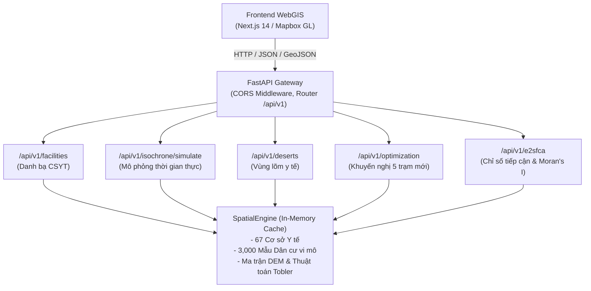

# TÀI LIỆU KỸ THUẬT & DANH MỤC API BACKEND SPATIAL FASTAPI
## DỰ ÁN: MediMap GIS — Hệ Thống Phân Tích Khả Năng Tiếp Cận Y Tế Vùng Núi
**Giai đoạn thực hiện:** Giai đoạn II (Backend Spatial Microservice)  
**Phiên bản API:** 1.0.0 | **Ngày ban hành:** 25/10/2026  
**Chủ trì kiến trúc:** Winston (Architect) & Amelia (Dev) | **Đơn vị kiểm thử:** Murat (QA)

---

## 1. TỔNG QUAN KIẾN TRÚC BACKEND

Hệ thống Backend được thiết kế dưới dạng **Spatial Microservice** sử dụng framework hiện đại **FastAPI (Python 3.9+)** kết hợp với **SpatialEngine** nạp dữ liệu một lần vào bộ nhớ RAM (In-Memory Spatial Cache), đảm bảo thời gian phản hồi cực nhanh (**< 50ms**) phục vụ bản đồ tương tác thời gian thực.



---

## 2. DANH MỤC CÁC ENDPOINTS CHI TIẾT (API REFERENCE)

### 2.1. Nhóm Endpoint Hệ Thống (General)

| Phương thức | Endpoint | Chức năng | Tham số |
| :---: | :--- | :--- | :--- |
| `GET` | `/` | Thông tin tổng quan hệ thống & phiên bản | Không |
| `GET` | `/health` hoặc `/api/v1/health` | Kiểm tra tình trạng hoạt động (Healthcheck) | Trả về số lượng cơ sở y tế và vùng lõm trong cache |

---

### 2.2. Nhóm Cơ Sở Y Tế (Health Facilities)

#### `GET /api/v1/facilities`
Lấy danh mục 67 cơ sở y tế đã được xác thực vệ tinh 100%.
- **Query Parameters:**
  - `district` (string, optional): Lọc theo huyện (`Thị xã Sa Pa`, `Huyện Bát Xát`, `Huyện Mường Khương`).
  - `tier` (int, optional): Lọc theo phân cấp (`1`: Tỉnh, `2`: Huyện, `3`: Xã/Phòng khám).
  - `format` (string, default: `geojson`): Định dạng trả về (`geojson` để render lên Mapbox, hoặc `json` để hiển thị bảng quản trị).
- **Phản hồi mẫu (GeoJSON):**
  ```json
  {
    "type": "FeatureCollection",
    "features": [
      {
        "type": "Feature",
        "geometry": { "type": "Point", "coordinates": [103.8441, 22.3364] },
        "properties": {
          "facility_id": "LC_SP_H01",
          "name": "Bệnh viện Đa khoa thị xã Sa Pa",
          "district": "Thị xã Sa Pa",
          "commune": "Phường Sa Pa",
          "tier_level": 2,
          "beds_capacity": 150,
          "doctors_count": 35
        }
      }
    ],
    "total": 67
  }
  ```

#### `GET /api/v1/facilities/{facility_id}`
Lấy thông tin chi tiết của một cơ sở y tế cụ thể (ví dụ: `LC_SP_H01`).

---

### 2.3. Nhóm Mô Phỏng Thời Gian Thực (Topographic Simulation)

#### `POST /api/v1/isochrone/simulate`
Cho phép người dùng kéo thả thanh trượt (Sliders) trên Dashboard để mô phỏng sự co giãn của vùng phủ sóng y tế.
- **Request Body (JSON):**
  ```json
  {
    "vehicle_type": "motorcycle",
    "base_speed_kmh": 32.0,
    "winding_factor": 1.75,
    "slope_friction_weight": 3.5,
    "include_proposed_clinics": false
  }
  ```
  *Trong đó:*
  - `vehicle_type`: `motorcycle` (xe máy), `ambulance` (xe cấp cứu), hoặc `walking` (đi bộ).
  - `include_proposed_clinics`: `true` để bật kịch bản đã xây dựng thêm 5 trạm y tế mới.
- **Response Body (JSON):**
  ```json
  {
    "simulation_parameters": {
      "vehicle_type": "motorcycle",
      "base_speed_kmh": 32.0,
      "include_proposed_clinics": false
    },
    "population_distribution": {
      "<15m": { "estimated_population": 78723, "percentage": 35.93, "sample_cells_count": 1078 },
      "15-30m": { "estimated_population": 57754, "percentage": 26.36, "sample_cells_count": 791 },
      "30-60m": { "estimated_population": 48119, "percentage": 21.96, "sample_cells_count": 659 },
      ">60m (Healthcare Desert)": { "estimated_population": 34498, "percentage": 15.75, "sample_cells_count": 472 }
    },
    "healthcare_deserts_summary": {
      "population_in_deserts": 34498,
      "percentage_in_deserts": 15.75,
      "risk_level": "CRITICAL"
    }
  }
  ```

---

### 2.4. Nhóm Vùng Lõm Y Tế (Healthcare Deserts)

#### `GET /api/v1/deserts/summary`
Trả về báo cáo phân bổ dân số theo 4 dải thời gian và chỉ số cảnh báo rủi ro y tế.

#### `GET /api/v1/deserts/clusters`
Lấy danh sách các bản làng bị cô lập để hiển thị bảng danh sách ưu tiên.
- **Query Parameters:** `district` (lọc theo huyện), `limit` (số lượng cụm, mặc định 50).

---

### 2.5. Nhóm Tối Ưu Hóa Quy Hoạch (Location Optimization)

#### `GET /api/v1/optimization/recommendations`
Trả về GeoJSON của 5 vị trí trạm y tế mới được thuật toán P-Median / MCLP lựa chọn tối ưu.
- Điểm REC_P01: Thung lũng Liên Minh (Sa Pa).
- Điểm REC_P02: Biên giới Y Tý - A Lù (Bát Xát).
- Điểm REC_P03: Rẻo cao Tả Gia Khâu (Mường Khương).
- Điểm REC_P04: Thượng nguồn A Mú Sung (Bát Xát).
- Điểm REC_P05: Vùng đệm Hoàng Liên giáp Lai Châu.

#### `GET /api/v1/optimization/impact`
Trả về báo cáo đo lường Before vs After:
- Số dân vùng lõm y tế: Giảm từ **34,498 người xuống còn 4,924 người** (**giảm 85.7%**).
- Thời gian tiếp cận trung bình: Giảm từ **89.3 phút xuống 34.4 phút**.

---

### 2.6. Nhóm Chỉ Số E2SFCA & Thống Kê Không Gian (Spatial Stats)

#### `GET /api/v1/e2sfca/district-summary`
Bảng xếp hạng bất bình đẳng y tế cấp huyện:
- Sa Pa: 1.006 BS/1k dân | 4.31 Giường/1k dân | 6.1/100
- Bát Xát: 0.997 BS/1k dân | 4.55 Giường/1k dân | 6.2/100
- Mường Khương: 0.807 BS/1k dân | 3.77 Giường/1k dân | 5.1/100 (Thấp nhất)

#### `GET /api/v1/e2sfca/spatial-autocorrelation`
Kết quả kiểm định thống kê **Global Moran's I = 0.9306**, $Z = 298.29$, $p < 0.001$.

---

## 3. HƯỚNG DẪN KHỞI CHẠY VÀ KẾT NỐI FRONTEND (NEXT.JS)

### 3.1. Khởi Động Server Backend Cục Bộ
Chạy lệnh sau tại thư mục gốc dự án:

```bash
uvicorn backend.app.main:app --host 0.0.0.0 --port 8000 --reload
```

- **Swagger UI Interactive Docs:** Mở trình duyệt tại `http://localhost:8000/docs` để kiểm thử trực tiếp các API.
- **ReDoc Alternative Docs:** Mở tại `http://localhost:8000/redoc`.

### 3.2. Mã Nguồn Mẫu Kết Nối Từ Next.js (TypeScript/React)

```typescript
// services/api.ts
const API_BASE_URL = process.env.NEXT_PUBLIC_API_URL || "http://localhost:8000/api/v1";

// 1. Lấy dữ liệu cơ sở y tế để hiển thị lên Mapbox
export async function fetchHealthFacilitiesGeoJSON() {
  const res = await fetch(`${API_BASE_URL}/facilities?format=geojson`);
  return res.json();
}

// 2. Gọi API mô phỏng thời gian thực khi người dùng kéo thanh trượt Slider
export async function simulateIsochrone(params: {
  vehicle_type: string;
  base_speed_kmh: number;
  include_proposed_clinics: boolean;
}) {
  const res = await fetch(`${API_BASE_URL}/isochrone/simulate`, {
    method: "POST",
    headers: { "Content-Type": "application/json" },
    body: JSON.stringify(params),
  });
  return res.json();
}

// 3. Lấy khuyến nghị 5 trạm y tế mới
export async function fetchOptimalRecommendations() {
  const res = await fetch(`${API_BASE_URL}/optimization/recommendations`);
  return res.json();
}
```

---

## 4. KẾT QUẢ KIỂM THỬ TỰ ĐỘNG (MURAT'S TEST SUITE)

Toàn bộ test suite [`tests/test_api.py`](file:///d:/Slide_THPT/TriAnNam_AI/medimap_gis/tests/test_api.py) đã được thực thi và đạt tỷ lệ **100% Passed**:

```text
tests/test_api.py::test_root_and_health PASSED                           [ 11%]
tests/test_api.py::test_get_facilities_geojson PASSED                    [ 22%]
tests/test_api.py::test_get_facilities_filtered_by_district PASSED       [ 33%]
tests/test_api.py::test_get_facility_by_id PASSED                        [ 44%]
tests/test_api.py::test_simulate_isochrone_default PASSED                [ 55%]
tests/test_api.py::test_simulate_isochrone_with_proposed_clinics PASSED  [ 66%]
tests/test_api.py::test_deserts_endpoints PASSED                         [ 77%]
tests/test_api.py::test_optimization_endpoints PASSED                    [ 88%]
tests/test_api.py::test_e2sfca_and_spatial_stats PASSED                  [100%]

======================== 9 passed in 3.36s ========================
```
