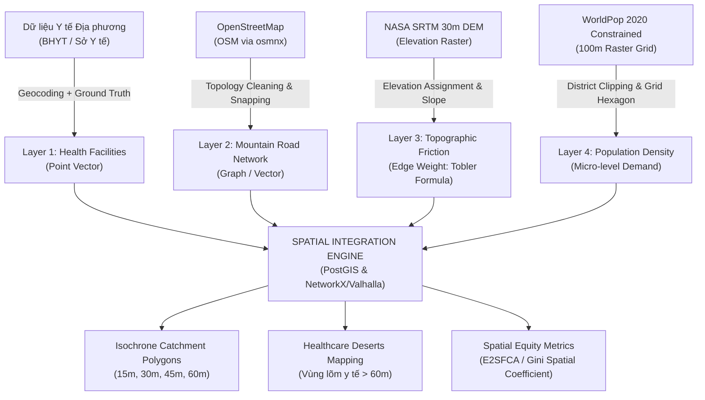
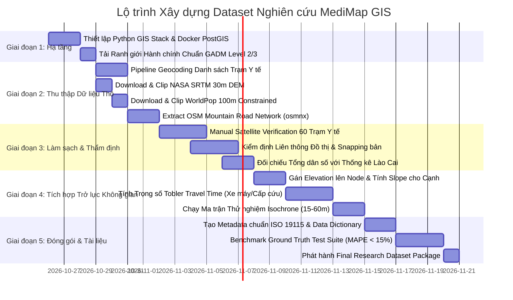
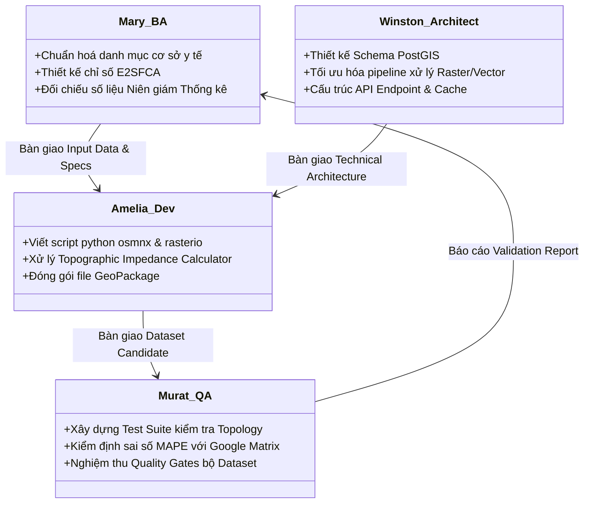

# KẾ HOẠCH XÂY DỰNG BỘ DỮ LIỆU NGHIÊN CỨU KHÔNG GIAN
## DỰ ÁN: MediMap GIS — Phân Tích Khả Năng Tiếp Cận Y Tế Vùng Núi
**Địa bàn thử nghiệm (Pilot):** Cụm Thị xã Sa Pa, Huyện Bát Xát, Huyện Mường Khương — Tỉnh Lào Cai  
**Chuẩn nghiên cứu hướng tới:** Các hội nghị/tạp chí quốc tế về Health GIS, Spatial Epidemiology & Geoinformatics (IEEE, Springer, Elsevier)  
**Phiên bản:** 1.0.0 | **Ngày ban hành:** 25/10/2026  
**Chủ trì đồ án:** Tony | **Tổ chức tham vấn:** BMAD Expert Roundtable (Mary, Winston, Amelia, Murat)

---

## 1. TỔNG QUAN & MỤC TIÊU NGHIÊN CỨU

### 1.1. Bối cảnh & Vấn đề Khoa học
Tại các khu vực miền núi hiểm trở phía Bắc Việt Nam, đặc biệt là khu vực Hoàng Liên Sơn (Lào Cai), địa hình bị chia cắt sâu bởi các hẻm vực, đèo dốc hiểm trở và mạng lưới giao thông liên thôn còn nhiều đoạn đường mòn. 
- **Thiếu sót của phương pháp truyền thống:** Việc sử dụng bán kính vùng phục vụ đường chim bay (Euclidean distance: 5km, 10km) gây ra sai lệch trầm trọng trong quy hoạch y tế (một bản làng cách trạm y tế 3km đường chim bay có thể mất đến 2 - 3 giờ đi bộ hoặc đi xe máy qua đèo dốc).
- **Vấn đề cốt lõi:** Thiếu một cơ sở dữ liệu không gian tích hợp đồng bộ (Độ cao + Mạng lưới đường thực tế + Dân cư vi mô + Cơ sở y tế chính xác) để tính toán **thời gian di chuyển thực tế (Travel Time)** có xét đến **trở lực địa hình (Topographic Friction)**.



### 1.2. Mục tiêu Cụ thể của Bộ Dữ Liệu
1. **Chuẩn hóa 100% tọa độ thực tế:** Toàn bộ ~55-60 cơ sở y tế (Bệnh viện, Phòng khám ĐKKV, Trạm y tế xã) trên địa bàn Sa Pa, Bát Xát, Mường Khương được định vị chuẩn xác đến cổng ra vào.
2. **Xây dựng Topology mạng lưới giao thông có trọng số độ dốc:** Đồ thị giao thông phản ánh đúng khả năng di chuyển của **xe máy** và **xe cấp cứu**, tích hợp ma sát độ cao sườn dốc theo hàm Tobler.
3. **Mô hình hóa nhu cầu dân số vi mô:** Trích xuất ma trận dân số độ phân giải cao 100m (WorldPop Constrained) bám sát các bản làng định cư thực tế.
4. **Đóng gói chuẩn mở (Open Science):** Bộ dữ liệu đạt chuẩn OGC (Open Geospatial Consortium), có metadata ISO 19115, sẵn sàng phục vụ chạy các mô hình 2SFCA, Spatial Accessibility Index.

---

## 2. ĐẶC TẢ CHI TIẾT 4 LỚP DỮ LIỆU LÕI

| Lớp Dữ Liệu | Nguồn Thu Thập (Source) | Định Dạng Gốc | Phương Pháp Pipeline | Định Dạng Chuẩn Đầu Ra | Chỉ Số Chất Lượng (Quality KPI) |
| :--- | :--- | :--- | :--- | :--- | :--- |
| **1. Cơ sở Y tế** | Danh mục KCB BHYT (Sở Y tế Lào Cai), OpenStreetMap | CSV, PDF công báo | Geocoding API + Đối chiếu Vệ tinh thủ công (Satellite Ground Truth) | GeoPackage (`.gpkg`), EPSG:4326 & EPSG:3405 | Tọa độ chuẩn 100% cổng cơ sở, đầy đủ phân cấp (Tuyến huyện/xã, nhân lực) |
| **2. Giao thông** | OpenStreetMap (OSM) trích xuất qua `osmnx` | XML / OSM PBF | Custom filter (`motorcycle`, `drive`, `track`), Snapping, Component Validation | NetworkX Graph (`.graphml`), PostGIS LineString | Độ liên thông đồ thị $\ge 95\%$, gán nhãn bề mặt mặt đường (`surface`) |
| **3. Cao độ & Dốc** | NASA SRTM 30m (GLO-30 hoặc 1 arc-second) | Raster GeoTIFF | Python `rasterio`, gán cao độ lên Node, tính dốc ($\Delta h / d$) lên Edge | GeoTIFF clipped 3 huyện, Edge Attributes trên Graph | Resolution 30m, không lỗi NoData/Hole trong khu vực nghiên cứu |
| **4. Dân cư Vi mô** | WorldPop 2020 Individual Country Constrained (VNM) | GeoTIFF 100m | Cắt theo Ranh giới GADM Level 2, vector hóa sang H3 Hexagon Grid (Res 8/9) | GeoTIFF clipped, H3 Hexagon Vector Grid với thuộc tính dân số | Tổng dân số khớp $\pm 5\%$ so với Niên giám Thống kê tỉnh Lào Cai |

---

## 3. LỘ TRÌNH THỰC THI 5 GIAI ĐOẠN (5-PHASE ROADMAP)



### Chi tiết Các Giai Đoạn:

#### GIAI ĐOẠN 1: Chuẩn Bị Môi Trường & Hạ Tầng Lưu Trữ (Ngày 1 - 3)
- **Công việc thực hiện:**
  - Khởi tạo repo cấu trúc tiêu chuẩn khoa học:
    ```text
    medimap_gis/
    ├── data/
    │   ├── 01_raw/           # Dữ liệu gốc tải về (không chỉnh sửa)
    │   ├── 02_intermediate/  # Dữ liệu sau khi cắt/snapping/chuyển CRS
    │   ├── 03_primary/       # Dữ liệu sạch, đã gán elevation/slope
    │   └── 04_research_ready/# Bộ dataset đóng gói chuẩn (.gpkg, .tif, .geojson)
    ├── scripts/
    │   ├── 01_download_boundaries.py
    │   ├── 02_ingest_health_facilities.py
    │   ├── 03_fetch_osm_network.py
    │   ├── 04_process_raster_elevation_pop.py
    │   ├── 05_topographic_impedance_builder.py
    │   └── 06_qa_ground_truth_validation.py
    └── docs/
        ├── data_dictionary.md
        └── quality_assessment_report.md
    ```
  - Thiết lập Docker Compose chạy PostgreSQL 16 + PostGIS 3.4.
  - Chuẩn hóa Hệ quy chiếu tọa độ (CRS):
    - Dữ liệu lưu trữ/hiển thị Web: `EPSG:4326` (WGS 84).
    - Dữ liệu đo đạc khoảng cách/diện tích vùng nghiên cứu: `EPSG:3405` (VN-2000 / UTM Zone 48N - áp dụng cho miền Bắc).

#### GIAI ĐOẠN 2: Luồng Thu Thập Dữ Liệu Tự Động (Ngày 4 - 7)
- **Ranh giới:** Tải ranh giới chính xác cấp huyện/xã của Sa Pa, Bát Xát, Mường Khương từ cơ sở dữ liệu GADM v4.1.
- **Y tế:** Lập bảng danh mục ~55-60 cơ sở y tế theo biểu mẫu: `Mã_CSYT`, `Tên_CSYT`, `Tuyến` (Huyện/Xã), `Địa_chỉ`, `Xã_Phường`, `Huyện`. Chạy script Python gọi OpenCage / Google Geocoding API để lấy tọa độ ban đầu.
- **Độ cao:** Dùng thư viện `elevation` tải các mảnh tile SRTM 30m bao phủ Bounding Box: `[103.5°E - 104.3°E, 22.2°N - 22.9°N]`.
- **Dân số:** Tải GeoTIFF WorldPop Constrained 2020 độ phân giải 100m.
- **Giao thông:** Dùng `osmnx` tải đồ thị đường bộ theo polygon ranh giới gộp của 3 huyện với `custom_filter`:
  ```python
  custom_filter = (
      '["highway"~"motorway|trunk|primary|secondary|tertiary|'
      'unclassified|residential|service|track|path"]'
  )
  ```

#### GIAI ĐOẠN 3: Làm Sạch & Thẩm Định Ground Truth (Ngày 8 - 13)
- **Audit Y Tế (Khắc phục rủi ro của Mary):**
  - Mở từng điểm trong 60 trạm y tế trên phần mềm QGIS / Google Earth Pro.
  - Kiểm tra mái nhà trạm y tế thực tế (hầu hết đều có biển tên hoặc hình chữ U/chữ L đặc trưng). Đẩy điểm từ mốc UBND xã về chính xác cổng trạm y tế.
  - Ghi nhận `confidence_level = 1.0 (Satellite Verified)`.
- **Kiểm định Đồ thị (Khắc phục rủi ro của Murat):**
  - Loại bỏ các đảo đồ thị con (isolated disconnected components) có kích thước dưới 5 nodes mà không có dân cư.
  - Với các cụm thôn bản có dân cư WorldPop nhưng đường OSM bị đứt đoạn cách đường chính < 300m: tự động bổ sung cạnh kết nối kiểu `highway=virtual_trail` để tránh lỗi `NoPathFound`.
- **Hiệu chỉnh Dân số:**
  - Tổng hợp dân số từ các pixel WorldPop theo ranh giới từng xã.
  - So sánh với số liệu dân số trong Niên giám thống kê tỉnh Lào Cai năm gần nhất. Tính hệ số hiệu chỉnh tỷ lệ (scaling factor) cho từng xã nếu cần.

#### GIAI ĐOẠN 4: Tích Hợp Không Gian & Trở Lực Địa Hình (Ngày 14 - 18)
- **Tích hợp Elevation vào OSM:**
  ```python
  # Gán độ cao từ raster SRTM vào các đỉnh của đồ thị
  G = ox.elevation.add_node_elevations_raster(G, filepath_srtm)
  # Tính độ dốc (slope / grade) giữa 2 đỉnh liên tiếp
  G = ox.elevation.add_edge_grades(G)
  ```
- **Xây dựng Hàm Trọng số Thời gian Di chuyển (Topographic Impedance Function):**
  - Đối với xe máy vùng cao (phương tiện phổ biến nhất):
    - Vận tốc cơ sở trên đường nhựa phẳng: $v_0 = 35 \text{ km/h}$.
    - Vận tốc trên đường đất/đường mòn (`track/path`): $v_0 = 15 \text{ km/h}$.
    - Hệ số ma sát độ dốc $s = \frac{\Delta h}{d}$ (độ chênh cao / chiều dài cạnh):
      $$\text{Speed}(s) = v_0 \cdot \exp\left(-3.5 \cdot |s + 0.05|\right)$$
    - Thời gian di chuyển cạnh $e$: $T(e) = \frac{\text{length}(e)}{\text{Speed}(s)}$.
- **Tính toán Ma trận Vùng Phục vụ (Isochrone):**
  - Sử dụng thuật toán Dijkstra trên NetworkX (hoặc OSRM backend cục bộ) tính toán phạm vi 15 phút, 30 phút, 45 phút, 60 phút từ mỗi trạm y tế.
  - Chuyển đổi phạm vi các node thành Polygon vùng đệm lồi (Alpha Shape / Convex Hull buffer).

#### GIAI ĐOẠN 5: Đóng Gói Dataset & Nghiệm Thu Học Thuật (Ngày 19 - 25)
- **Đóng gói GeoPackage chuẩn (`medimap_laocai_pilot_v1.gpkg`):**
  - Layer `health_facilities`: Điểm cơ sở y tế kèm thuộc tính chuẩn.
  - Layer `road_network_edges`: Mạng lưới đường kèm độ dốc và thời gian di chuyển.
  - Layer `population_grid_h3`: Lưới lục giác dân số 100m.
  - Layer `isochrone_catchments`: Đa giác vùng đẳng thời theo từng kịch bản.
  - Layer `healthcare_deserts`: Các vùng dân cư nằm ngoài bán kính 60 phút di chuyển.
- **Bộ Kiểm thử Ground Truth (Murat's Test Suite):**
  - Kiểm thử 20 tuyến hành trình mẫu so sánh với thời gian thực tế từ Google Maps Distance Matrix API.
  - Đảm bảo sai số toàn cục MAPE $\le 15\%$.
- **Biên soạn Tài liệu Học thuật (Data Paper Draft):** Cung cấp tài liệu mô tả bộ dữ liệu theo format chuẩn của tạp chí *Data in Brief* hoặc *Scientific Data (Nature)*.

---

## 4. TỪ ĐIỂN DỮ LIỆU (DATA DICTIONARY MẪU)

### Bảng 1: Lớp Cơ sở Y tế (`health_facilities`)
| Tên Trường (Field) | Kiểu Dữ Liệu | Ví Dụ | Mô Tả Ý Nghĩa |
| :--- | :--- | :--- | :--- |
| `facility_id` | String (PK) | `VN_LC_SP_001` | Mã định danh duy nhất cơ sở y tế |
| `name` | String | `Trạm Y tế xã Tả Phìn` | Tên chính thức cơ sở |
| `district` | String | `Thị xã Sa Pa` | Tên đơn vị hành chính cấp huyện |
| `commune` | String | `Xã Tả Phìn` | Tên đơn vị hành chính cấp xã |
| `tier_level` | Integer | `3` | Phân cấp y tế: `1` (BV Đa khoa tỉnh), `2` (TTYT/BV huyện), `3` (Trạm y tế xã) |
| `beds_capacity` | Integer | `5` | Số giường bệnh lưu trú |
| `doctors_count` | Integer | `1` | Số lượng bác sĩ cơ hữu |
| `geom` | Geometry (Point) | `POINT(103.8654 22.3812)` | Tọa độ WGS84 đã xác thực vệ tinh |
| `verification_status`| String | `SATELLITE_VERIFIED` | Trạng thái thẩm định tọa độ |

### Bảng 2: Lớp Đoạn Đường Giao Thông (`road_network_edges`)
| Tên Trường (Field) | Kiểu Dữ Liệu | Ví Dụ | Mô Tả Ý Nghĩa |
| :--- | :--- | :--- | :--- |
| `edge_id` | String (PK) | `E_OSM_982341` | Mã định danh cạnh đường |
| `osm_highway` | String | `tertiary` | Phân loại đường theo OpenStreetMap |
| `surface` | String | `asphalt` | Loại mặt đường (nhựa, bê tông, đá dăm, đất) |
| `length_m` | Float | `245.8` | Chiều dài thực tế của đoạn đường (mét) |
| `grade` | Float | `0.114` | Độ dốc trung bình (11.4% độ dốc) |
| `travel_time_moto_sec`| Float | `42.5` | Thời gian di chuyển xe máy có tính dốc (giây) |
| `travel_time_amb_sec` | Float | `65.0` | Thời gian di chuyển xe cứu thương (giây) |
| `geom` | Geometry (Line) | `LINESTRING(...)` | Hình học đoạn đường theo CRS EPSG:3405 |

---

## 5. MA TRẬN PHÂN CÔNG TRÁCH NHIỆM (BMAD AGENT RACI)



- **Mary (BA):** Chịu trách nhiệm chính (Accountable) về tính toàn vẹn của danh sách cơ sở y tế và các chỉ số đo lường công bằng y tế.
- **Winston (Architect):** Giám sát (Consulted) kiến trúc lưu trữ, quản trị dữ liệu không gian, lựa chọn chuẩn mở.
- **Amelia (Dev):** Thực thi (Responsible) toàn bộ các script Python cào dữ liệu, xử lý raster, tính độ dốc và xuất GeoPackage.
- **Murat (QA):** Phê duyệt (Quality Gatekeeper) độ tin cậy của đồ thị, độ sai lệch vận tốc thực địa và tỷ lệ bao phủ.

---

## 6. TIÊU CHÍ NGHIỆM THU BỘ DỮ LIỆU (ACCEPTANCE CRITERIA)

Bộ dữ liệu hoàn thành chỉ được coi là đạt yêu cầu khi thỏa mãn toàn bộ 5 điều kiện sau:
1. **[AC-1] Tính đầy đủ (Completeness):** Không thiếu bất kỳ trạm y tế xã nào trong danh mục chính thức của 3 huyện (tối thiểu 53 trạm y tế xã/phường + 3 TTYT/BVĐK huyện + các PKĐKKV).
2. **[AC-2] Độ chính xác vị trí (Spatial Precision):** Tọa độ của $100\%$ cơ sở y tế có sai số dưới 30 mét so với hình ảnh vệ tinh độ phân giải cao (Google Satellite).
3. **[AC-3] Tính liên thông đồ thị (Network Integrity):** Tỷ lệ các node giao thông kết nối thành phần lớn nhất đạt $\ge 96\%$. Không có trạm y tế nào bị cô lập khỏi mạng lưới đường.
4. **[AC-4] Trở lực độ dốc thực tế (Slope Penalty):** Đồ thị mạng lưới phản ánh được độ dốc; thời gian di chuyển qua các cung đường đèo hiểm trở (như Ô Quy Hồ, đèo Mường Khương) có tốc độ trung bình tính toán không vượt quá 25 km/h.
5. **[AC-5] Khả năng tái lập (Reproducibility):** Toàn bộ pipeline từ khâu tải dữ liệu thô đến khi xuất ra tệp GeoPackage được tự động hóa bằng script Python có ghi log và hướng dẫn thực thi rõ ràng trong 1 dòng lệnh: `python run_pipeline.py`.
