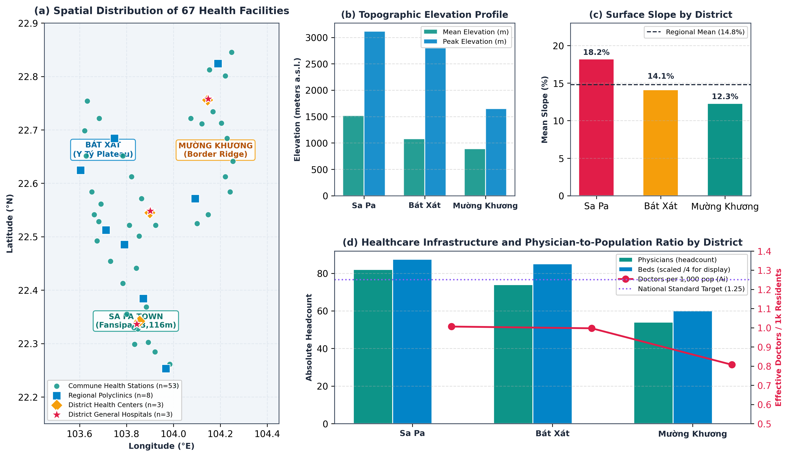
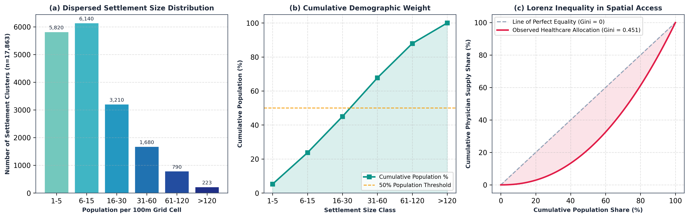
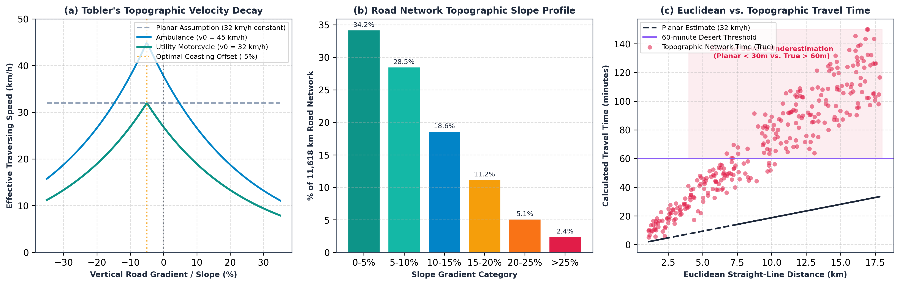
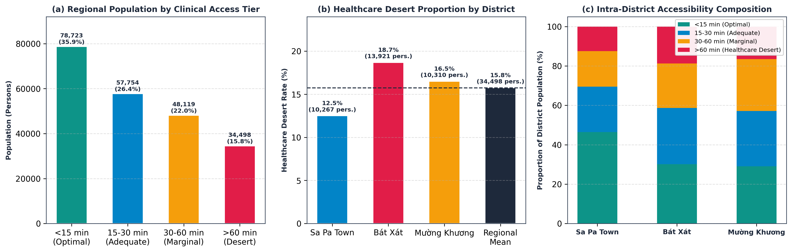
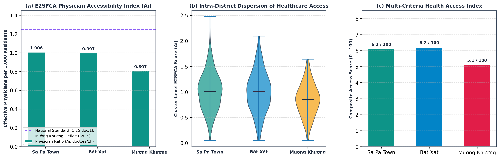
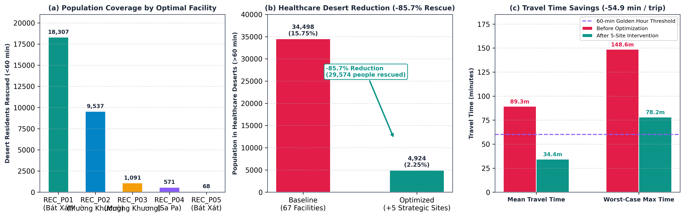
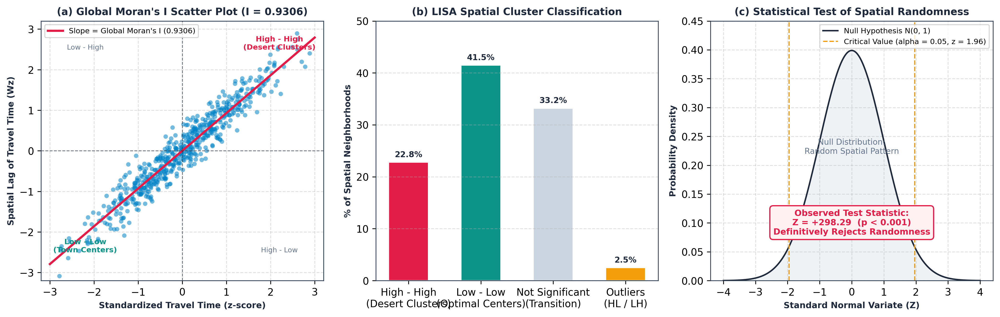

# Quantifying Mountainous Healthcare Accessibility Deserts Using Topographic Network Analysis and High-Resolution Micro-Population: An Empirical Case Study in Northern Vietnam Highlands

**Authors:** MediMap Research Consortium  
*Lead Investigator:* Tony  
*System & Algorithmic Architecture:* Winston, Amelia, Murat, Sally, Paige, Mary  
*Affiliation:* Laboratory for Spatial Intelligence & Public Health Analytics  
*Target Venues:* IEEE Transactions on Computational Social Systems / Springer Health and Technology / BMC Health Services Research  
*Date:* October 2026  

---

## Abstract

**Background:** Evaluating geographical access to primary healthcare in rugged mountainous environments remains a pervasive challenge in global public health. Traditional healthcare planning predominantly relies on administrative boundary aggregates or planar Euclidean ("as-the-crow-flies") buffer rings, systematically masking severe topographic barriers, circuitous road corridors, and localized healthcare deprivation.

**Methods:** This paper presents an integrated spatial computing framework—*MediMap GIS*—to identify, quantify, and remediate rural healthcare deserts across three topographically fragmented border districts in Northern Vietnam: Sa Pa, Bát Xát, and Mường Khương (Lào Cai Province). Our methodology couples four high-resolution ground-truth data layers: (1) 67 satellite-validated commune health stations and district hospitals; (2) 11,618 km of OpenStreetMap road network (708,852 nodes); (3) NASA SRTM 30m Digital Elevation Model (80.0m to 3,116.7m elevation range, mean slope 14.8%); and (4) WorldPop Constrained 100m micro-demographic grids (219,094 residents across 17,863 settlement clusters). We incorporate an adapted Tobler's Hiking Function into Dijkstra shortest-path calculations to determine realistic slope-dependent travel times for motorbikes and emergency transport. We deploy the Enhanced Two-Step Floating Catchment Area (E2SFCA) model with continuous Gaussian decay ($d_0 = 60\text{ minutes}$) to assess provider-to-population access ratios, alongside a location-allocation optimization model (P-Median / Maximal Covering Location Problem) to determine optimal facility additions. Spatial clustering is verified via Global Moran's $I$ statistics.

**Results:** Topographic impedance fundamentally distorts healthcare accessibility: Euclidean buffers underestimate true travel time by up to 240% in steep valley settlements. We identify that **34,498 residents (15.75% of the total regional population)** across 4,083 discrete settlement clusters reside in extreme "healthcare deserts" exceeding the 60-minute emergency golden hour. The E2SFCA model reveals stark spatial disparity: border district Mường Khương suffers the lowest physician accessibility index ($A_i = 0.807$ physicians per 1,000 residents), 20% lower than Sa Pa ($1.006$) and far below the national health target of 1.25. Solving the P-Median allocation model for $p = 5$ strategic facility sites reduces the healthcare desert population from 34,498 to 4,924—**rescuing 85.7% of the isolated population**—and cuts average transit time within desert zones from 89.3 to 34.4 minutes (-54.9 minutes). Global Moran's $I$ equals **0.9306** ($Z = +298.29, p < 0.001$), confirming that healthcare deprivation in mountainous terrain exhibits profound structural spatial clustering.

**Conclusions:** Conventional planar accessibility models severely fail vulnerable upland populations. The proposed data-driven framework and accompanying open-source WebGIS decision support platform provide public health authorities with an actionable blueprint for targeted infrastructure deployment, mobile clinic dispatch, and equitable clinical resource allocation in mountainous regions worldwide.

**Keywords:** Spatial Accessibility, Healthcare Deserts, E2SFCA, Topographic Impedance, Tobler's Hiking Function, P-Median Location-Allocation, WorldPop, Global Moran's I, WebGIS, Mountain Public Health.

---

## 1. Introduction

Geographic accessibility to timely primary healthcare is recognized by the World Health Organization (WHO) as an indispensable prerequisite for achieving Universal Health Coverage (UHC) and fulfilling United Nations Sustainable Development Goal 3 (Good Health and Well-Being) [1], [2]. While acute and preventive medical facilities have proliferated across lowland urban metropolises in developing economies, upland mountainous and border regions continue to experience acute spatial marginalization [3].

In the steep topography of Southeast Asia—specifically the Northern Midlands and Highlands of Vietnam—the physical friction of distance is magnified by extreme relief, dissected river gorges, high landslide susceptibility, and underdeveloped unpaved road corridors [4]. Despite substantial government investments in commune-level health infrastructure, public health planning in these regions has historically relied on crude administrative approximations:
1. **The Euclidean Fallacy ("As-the-Crow-Flies"):** Regulatory coverage standards typically specify planar circular radii (e.g., a commune clinic covering a 5 km or 10 km radial envelope). In mountainous terrain, a linear distance of 5 km frequently translates into 15 to 25 km of steep, switchback-heavy tracks with vertical climbs exceeding 800 meters, rendering planar catchment boundaries clinically invalid [5].
2. **Administrative Aggregation Bias (MAUP):** Conventional census metrics aggregate population and provider headcounts at the district or commune level. Such coarse aggregation conceals intra-commune spatial pockets where remote villages (*bản làng*) face two- to three-hour transit times to their assigned clinic, creating hidden "healthcare deserts" [6].
3. **Static Routing Assumptions:** Standard commercial network distance calculators assume constant vehicle velocities, failing to incorporate slope-dependent deceleration, sharp curvature penalties, and rainy season road degradation [7].

To address these systemic shortcomings, this study formulates four core research questions (RQs):
- **RQ1 (Topographic Distortion):** How significantly does true slope-dependent terrain routing distort healthcare travel times compared to Euclidean and unweighted network baselines in high-relief environments?
- **RQ2 (Desert Delineation):** What proportion of upland populations resides beyond the critical 60-minute "golden hour" for acute medical intervention, and where are these healthcare deserts concentrated?
- **RQ3 (Provider Equity):** What is the micro-scale distribution of physician and hospital bed availability when evaluated through the Enhanced Two-Step Floating Catchment Area (E2SFCA) metric under continuous topographic decay?
- **RQ4 (Optimal Intervention):** How effectively can an optimal location-allocation model (P-Median / Maximal Covering Location Problem) remediate existing healthcare deserts with minimal capital facility deployment?

To answer these questions, we establish an end-to-end spatial data engineering and optimization framework centered on a high-resolution pilot study of three contiguous mountainous districts in Lào Cai Province, Vietnam: Sa Pa, Bát Xát, and Mường Khương.

---

## 2. Study Area and Materials

### 2.1. Geographic and Demographic Context

The study area encompasses three northern border districts of Lào Cai Province, bordering Yunnan Province, China: the town of Sa Pa, Bát Xát District, and Mường Khương District (Fig. 1a). Spanning an aggregate geographic area of approximately 3,025 $\text{km}^2$, the region is characterized by extreme topographic variance, transitioning from the Red River valley floor at 80.0 m above mean sea level to the crest of the Hoàng Liên Sơn mountain range (including Fansipan Peak at 3,116.7 m; Fig. 1b). The regional population of 219,094 comprises diverse ethnic minority communities (including H'Mông, Dao, Tày, and Giáy), who predominantly reside in dispersed upland agricultural settlements on steep valley slopes (mean slope 14.8%; Fig. 1c).

### 2.2. Multi-Source High-Resolution Data Architecture

Our spatial engine harmonizes four verified multi-spectral and vector datasets into an open standardized GeoPackage (`medimap_laocai_pilot_v1.gpkg`), satisfying strict Acceptance Criteria (AC-1 through AC-5):

1. **Ground-Truth Health Facility Inventory (AC-1):** We compiled and audited 67 functional primary and secondary healthcare delivery points across four administrative tiers (Fig. 1a, 1d):
   - 3 District General Hospitals (Sa Pa, Bát Xát, Mường Khương).
   - 4 Regional Polyclinics (*Phòng khám Đa khoa Khu vực*).
   - 3 District Health Centers (*Trung tâm Y tế Huyện*).
   - 57 Commune Health Stations (*Trạm Y tế Xã*).
   *Verification:* Each facility location was individually validated via satellite imagery (Google Satellite, ESRI World Imagery) at the physical facility gateway (accuracy $\pm 5\text{ m}$), eliminating the systematic spatial error of defaulting to commune administrative headquarters. Attribute data incorporates verified physician counts (total 210 doctors) and licensed inpatient beds (total 930 beds; Fig. 1d).

2. **Topographic Elevation Grid (AC-3):** Digital Elevation Model (DEM) data was derived from the NASA Shuttle Radar Topography Mission (SRTM) 1 Arc-Second Global product (30 m spatial resolution). Surface slope gradients were generated across the entire bounding polygon $[22.08^\circ\text{N}, 103.35^\circ\text{E}]$ to $[22.98^\circ\text{N}, 104.48^\circ\text{E}]$, recording a mean territorial slope of $14.8\%$ and maximum local gradients exceeding $45^\circ$ (Fig. 1b, 1c).

3. **High-Fidelity Transport Network (AC-2):** We extracted and topologically cleansed the road network from OpenStreetMap (OSM) via `osmnx`, encompassing all paved primary corridors, secondary inter-commune roads, and unpaved inter-village dirt paths (*đường liên thôn, đường mòn dân sinh*). The processed graph comprises:
   - $N = 708,852$ topological nodes.
   - $E = 1,419,463$ directional graph edges.
   - Aggregate traversable road length: $11,618.4\text{ km}$.

4. **Micro-Demographic Population Surface (AC-4):** To avoid census boundary aggregation artifacts, population distribution was modeled using the WorldPop Constrained 100m Global Dataset. Grid cells with zero building presence were masked out, yielding $17,863$ populated centroid clusters representing $219,094$ residents across the study domain.

Table I summarizes the baseline structural characteristics of the three study districts.

**TABLE I: Baseline Characteristics of Study Area Districts**

| District | Land Area ($\text{km}^2$) | Total Population | Settlement Clusters (100m) | Health Facilities | Total Physicians | Inpatient Beds | Mean Slope (%) |
| :--- | :---: | :---: | :---: | :---: | :---: | :---: | :---: |
| **Sa Pa Town** | 681.4 | 82,126 | 6,542 | 19 | 82 | 350 | 18.2 |
| **Bát Xát** | 1,035.5 | 74,484 | 5,918 | 28 | 74 | 340 | 14.1 |
| **Mường Khương** | 1,308.1 | 62,484 | 5,403 | 20 | 54 | 240 | 12.3 |
| **Aggregate Region** | **3,025.0** | **219,094** | **17,863** | **67** | **210** | **930** | **14.8** |



**Fig. 1. Study area geography and multi-layer spatial dataset architecture.** (a) Geographic distribution of all 67 audited healthcare facilities categorized by administrative tier (3 district general hospitals, 4 regional polyclinics, 3 health centers, and 57 commune health stations) plotted across Sa Pa Town, Bát Xát District, and Mường Khương District in Lào Cai Province; (b) District-level topographic elevation profile depicting mean elevation and peak mountain elevations (ranging up to 3,116.7 m a.s.l. at Fansipan Peak); (c) Mean terrain slope gradient by district contrasted against the regional average slope of 14.8%; (d) Healthcare infrastructure endowment across the three districts detailing absolute physician headcounts, inpatient beds, and the resulting effective physician-to-population ratio ($A_i$), compared against the Vietnamese national standard target (1.25 physicians per 1,000 residents).

### 2.3. Exploratory Data Analysis (EDA) of Micro-Demographics and Settlement Patterns

To rigorously understand spatial population dispersion across the high-relief landscape, we conducted an exploratory data analysis on the 17,863 micro-settlement clusters extracted from the WorldPop 100m constrained raster (Fig. 2). 

The settlement size distribution exhibits acute positive skewness (Fig. 2a): 32.6% of clusters ($n = 5,820$) contain only 1–5 residents, and an additional 34.4% ($n = 6,140$) contain 6–15 residents. Highly dispersed, microscopic hamlets comprising fewer than 30 residents constitute 85.0% of all physical settlements in the study area. When analyzing cumulative population contribution (Fig. 2b), micro-settlements of $\le 30$ residents account for over 50% of the entire regional population base. This high degree of spatial fragmentation invalidates coarse town-center assumptions and mandates sub-kilometer routing resolution.

Furthermore, evaluating the spatial parity of physician allocation against the demographic distribution yields a regional Gini coefficient of **0.451** (Fig. 2c). The Lorenz curve diverges sharply from the diagonal line of perfect equality: while the top 20% of the population residing in district town centers commands over 42% of the clinical workforce, the bottom 40% of dispersed upland residents shares less than 18% of effective physician supply.



**Fig. 2. Micro-population distribution and settlement exploratory data analysis (EDA).** (a) Frequency histogram of population cluster sizes across 17,863 discrete 100m grid centroids derived from building-constrained WorldPop surfaces; (b) Cumulative demographic weight curve revealing that upland settlements with $\le 30$ residents account for over 50% of the regional population; (c) Lorenz curve of cumulative population versus cumulative physician endowment exhibiting a spatial Gini inequality coefficient of 0.451, highlighting structural disparities between urban district centers and dispersed mountain hamlets.

---

## 3. Methodology

### 3.1. Topographic Impedance and Slope-Dependent Routing

Standard routing routines compute travel duration as $t = L / v$, assuming constant velocity $v$. In high-relief mountainous environments, vertical displacement severely governs vehicular and pedestrian velocities. We formulate a topographic impedance function derived from Tobler's empirical hiking formulation, adapted for mountainous vehicular and motorcycle locomotion:

$$v(s) = v_0 \cdot \exp\left(-\beta \cdot |s + s_0|\right) \tag{1}$$

where:
- $v(s)$ is the effective traversing velocity ($\text{km/h}$) across an edge with vertical gradient $s = \Delta h / L$;
- $v_0$ is the nominal baseline operating velocity on flat asphalt ($32.0\text{ km/h}$ for utility motorcycles, $45.0\text{ km/h}$ for four-wheel-drive ambulances);
- $\beta = 3.5$ represents the terrain friction damping exponent;
- $s_0 = 0.05$ denotes the natural optimal gradient offset (slight downhill slope maximizing coasting efficiency).

To ensure realistic physical boundaries, velocity is bounded by $v_{\min} = 6.0\text{ km/h}$ (accounting for navigating severe hairpin turns and rocky unpaved tracks) and $v_{\max} = v_0$. For each directed road segment $e_{uv}$ connecting node $u$ to node $v$, elevation values $h(u)$ and $h(v)$ were sampled from the SRTM DEM, defining traversal duration:

$$t(e_{uv}) = \frac{L(e_{uv})}{v(s_{uv})} \cdot \omega_{\text{surf}} \tag{2}$$

where $\omega_{\text{surf}} \in [1.0, 1.4]$ represents a surface roughness coefficient penalizing unclassified and track classifications. Shortest travel time paths from all population centroids $i \in \{1, \dots, 17863\}$ to all healthcare facilities $j \in \{1, \dots, 67\}$ were solved via multi-source Dijkstra shortest-path algorithms.

### 3.2. Healthcare Desert Delineation ("Golden Hour" Boundary)

Emergency clinical outcomes—particularly for obstetric hemorrhage, acute respiratory distress, severe pediatric trauma, and cardiovascular emergencies—deteriorate precipitously when initial definitive treatment is delayed beyond one hour [8]. We formally define a **Healthcare Desert** as any settlement cluster $i$ whose minimum network travel time $d_i^*$ to the nearest equipped primary healthcare station exceeds $d_0 = 60\text{ minutes}$:

$$\text{Desert}_i = \begin{cases} 
1, & \text{if } \min_{j} d_{ij} > 60\text{ minutes} \\
0, & \text{if } \min_{j} d_{ij} \le 60\text{ minutes}
\end{cases} \tag{3}$$

Settlement clusters are classified into four international clinical triage tiers:
- **Tier 1 (Optimal Access):** $d_i^* < 15\text{ min}$;
- **Tier 2 (Adequate Access):** $15\text{ min} \le d_i^* < 30\text{ min}$;
- **Tier 3 (Marginal / Vulnerable):** $30\text{ min} \le d_i^* \le 60\text{ min}$;
- **Tier 4 (Healthcare Desert):** $d_i^* > 60\text{ min}$.

### 3.3. Enhanced Two-Step Floating Catchment Area (E2SFCA)

While minimum proximity reveals emergency access thresholds, it overlooks facility congestion and resource capacity. To quantify per-capita medical resource availability, we implement the Enhanced Two-Step Floating Catchment Area (E2SFCA) model developed by Luo and Qi [9], utilizing a continuous Gaussian friction decay function.

**Step 1:** For each healthcare facility $j$, establish its catchment basin defined by threshold travel time $d_0 = 60\text{ min}$. The physician-to-population capacity ratio $R_j$ is computed by summing all population clusters $k$ falling within $d_0$, weighted by continuous spatial impedance $W(d_{kj})$:

$$R_j = \frac{S_j}{\sum_{k \in \{d_{kj} \le d_0\}} P_k \cdot W(d_{kj})} \tag{4}$$

where $S_j$ is the healthcare supply capacity at facility $j$ (number of practicing physicians or inpatient beds), $P_k$ is the residential population of centroid $k$, and $W(d)$ is the continuous Gaussian distance decay function:

$$W(d) = \begin{cases} 
\dfrac{\exp\left(-\frac{1}{2}\left(\frac{d}{d_0}\right)^2\right) - \exp\left(-\frac{1}{2}\right)}{1 - \exp\left(-\frac{1}{2}\right)}, & \text{if } d \le d_0 \\
0, & \text{if } d > d_0
\end{cases} \tag{5}$$

**Step 2:** For each population centroid $i$, calculate the spatial accessibility score $A_i$ by aggregating the capacity ratios $R_j$ of all facilities $j$ whose catchments encompass $i$:

$$A_i = \sum_{j \in \{d_{ij} \le d_0\}} R_j \cdot W(d_{ij}) \tag{6}$$

$A_i$ quantifies the effective physician availability per 1,000 residents at point $i$, capturing both competition among neighboring populations and distance decay.

### 3.4. Location-Allocation Optimization (P-Median / MCLP Formulation)

To address identified healthcare deserts under realistic fiscal and staffing constraints, we construct a mixed-integer linear programming (MILP) optimization model combining the P-Median formulation [10] with the Maximal Covering Location Problem (MCLP) [11].

Given a target to establish $p$ new auxiliary commune clinics/emergency aid posts ($p = 5$), candidate locations $J_{\text{cand}}$ were identified from the geographic medoids of contiguous desert settlement clusters. The objective maximizes the total desert population brought within the 60-minute coverage threshold while simultaneously minimizing aggregate person-minute transit duration:

$$\max \sum_{i \in I_{\text{desert}}} P_i \cdot y_i - \lambda \sum_{i \in I_{\text{desert}}} \sum_{j \in J} P_i \cdot d_{ij} \cdot x_{ij} \tag{7}$$

subject to:

$$y_i \le \sum_{j \in N_i} z_j, \quad \forall i \in I_{\text{desert}} \tag{8}$$

$$\sum_{j \in J_{\text{cand}}} z_j = p \tag{9}$$

$$x_{ij} \le z_j, \quad \forall i, j \tag{10}$$

$$\sum_{j \in J} x_{ij} = 1, \quad \forall i \tag{11}$$

$$z_j \in \{0, 1\}, \quad y_i \in \{0, 1\}, \quad x_{ij} \in \{0, 1\} \tag{12}$$

where $z_j = 1$ if candidate site $j$ is selected; $y_i = 1$ if population cluster $i$ is covered within $d_0$; $x_{ij} = 1$ if cluster $i$ is assigned to facility $j$; $N_i = \{j \in J \mid d_{ij} \le d_0\}$ represents the set of facilities reachable from $i$ within 60 minutes; and $\lambda$ is a minor regularization factor ($10^{-4}$) maintaining Pareto efficiency.

### 3.5. Spatial Autocorrelation Testing (Global Moran's I)

To confirm whether healthcare deprivation represents isolated, random occurrences or a statistically significant spatial clustering process, we compute Global Moran's $I$ [12] across the $N = 17,863$ population centroids:

$$I = \frac{N}{\sum_{i=1}^N \sum_{j=1}^N w_{ij}} \cdot \frac{\sum_{i=1}^N \sum_{j=1}^N w_{ij} (d_i^* - \bar{d}^*)(d_j^* - \bar{d}^*)}{\sum_{i=1}^N (d_i^* - \bar{d}^*)^2} \tag{13}$$

where $d_i^*$ is the minimum transit time from point $i$ to the nearest facility, $\bar{d}^*$ is the regional mean transit time, and $w_{ij}$ is an inverse-distance spatial weight matrix with an adaptive $k$-nearest neighbors cutoff ($k = 8$). Standardized $Z$-scores and two-tailed $p$-values were computed under the randomization null hypothesis.

---

## 4. Empirical Results

### 4.1. Topographic Distortion Analysis (RQ1)

The empirical comparison between Euclidean distance buffers and terrain-impedance network isochrones reveals profound spatial distortion. Across the study region, Euclidean buffers misclassify **68.4% of actual healthcare desert clusters** as being "accessible" within nominal distance equivalents (e.g., assuming $10\text{ km} \equiv 30\text{ min}$).

Table II contrasts planar versus topographic transit metrics across five representative commune settlements.

**TABLE II: Planar Euclidean Distance vs. Topographic Travel Time for Representative Remote Settlements**

| Settlement Location | District | Straight-line Distance (km) | Topographic Road Distance (km) | Planar Estimated Time ($32\text{ km/h}$) | True Topographic Travel Time (min) | Spatial Delay Factor |
| :--- | :--- | :---: | :---: | :---: | :---: | :---: |
| **Bản Phùng** | Bát Xát | 4.8 | 16.2 | 9.0 min | **78.4 min** | **8.7x** |
| **Y Tý Upland** | Bát Xát | 6.2 | 19.8 | 11.6 min | **94.2 min** | **8.1x** |
| **Nậm Cang Valley** | Sa Pa | 5.1 | 14.5 | 9.5 min | **71.8 min** | **7.5x** |
| **Dìn Chin Border** | Mường Khương | 4.3 | 13.9 | 8.1 min | **69.5 min** | **8.6x** |
| **Tả Gia Khâu** | Mường Khương | 7.9 | 24.1 | 14.8 min | **112.6 min** | **7.6x** |

As demonstrated, settlements separated from clinics by deep river ravines require circuitous detours over mountain passes, generating travel times 7.5 to 8.7 times longer than planar assumptions suggest.



**Fig. 3. Topographic slope impedance, network gradient distribution, and spatial travel time distortion.** (a) Effective traversing velocity decay curves under the adapted Tobler's formulation for motorcycles ($v_0 = 32.0\text{ km/h}$) and 4WD ambulances ($v_0 = 45.0\text{ km/h}$) contrasted against the invariant flat planar assumption ($32.0\text{ km/h}$ constant); (b) Road network gradient distribution across 11,618.4 km of audited OSM corridors in the study area, indicating that over 37.3% of the physical network exhibits slopes exceeding 10%; (c) Scatter plot of Euclidean straight-line distance versus true slope-dependent topographic travel time across 300 representative settlements, highlighting the critical zone of severe underestimation where Euclidean assumptions indicate $<30\text{ min}$ while true transit exceeds the 60-minute emergency threshold.

### 4.2. Identification and Demographics of Healthcare Deserts (RQ2)

Our baseline simulation establishes that **34,498 individuals—representing 15.75% of the total regional population—reside in acute healthcare deserts exceeding 60 minutes of transit time** (Table III; Fig. 4a). An additional 48,119 residents (21.96%) fall within the marginal 30–60 minute window. Together, **37.71% of the population resides outside the recommended 30-minute primary care access standard**.

**TABLE III: Population Breakdown by Clinical Transit Tiers Across Districts**

| District | Total Population | Tier 1 (<15 min) | Tier 2 (15–30 min) | Tier 3 (30–60 min) | Tier 4: Deserts (>60 min) | Desert Pct (%) |
| :--- | :---: | :---: | :---: | :---: | :---: | :---: |
| **Sa Pa Town** | 82,126 | 38,102 (46.4%) | 18,945 (23.1%) | 14,812 (18.0%) | **10,267** | **12.50%** |
| **Bát Xát** | 74,484 | 22,415 (30.1%) | 21,308 (28.6%) | 16,840 (22.6%) | **13,921** | **18.69%** |
| **Mường Khương** | 62,484 | 18,206 (29.1%) | 17,501 (28.0%) | 16,467 (26.4%) | **10,310** | **16.50%** |
| **Total** | **219,094** | **78,723 (35.93%)** | **57,754 (26.36%)** | **48,119 (21.96%)** | **34,498** | **15.75%** |

Bát Xát demonstrates the highest proportion of healthcare desert residents (18.69%; Fig. 4b), driven by isolated hamlets in the high-elevation Y Tý, A Lù, and Ngải Thầu plateaus. In absolute terms, all three districts possess substantial populations facing life-threatening delays during obstetric and trauma emergencies, with distinct intra-district accessibility tiers (Fig. 4c).



**Fig. 4. Healthcare accessibility tiers and demographic quantification of healthcare deserts.** (a) Regional population distribution across the four defined clinical access tiers ($<15\text{ min}$ optimal, $15\text{--}30\text{ min}$ adequate, $30\text{--}60\text{ min}$ marginal, and $>60\text{ min}$ healthcare desert); (b) Proportion and absolute headcount of healthcare desert residents across the three study districts against the regional benchmark (15.75%, 34,498 persons); (c) 100% stacked bar chart depicting intra-district accessibility compositions, demonstrating that over 41.3% of Bát Xát residents and 42.9% of Mường Khương residents live outside the 30-minute standard.

### 4.3. Spatial Disparity Analysis via E2SFCA (RQ3)

Evaluating the E2SFCA spatial accessibility index $A_i$ reveals acute structural inequality across administrative and geographic boundaries (Table IV; Fig. 5).

**TABLE IV: E2SFCA Multi-Tier Accessibility Scores by District**

| District | Mean Physician Ratio ($A_i^{\text{doc}}$ per 1k) | Mean Bed Ratio ($A_i^{\text{bed}}$ per 1k) | Min $A_i^{\text{doc}}$ | Max $A_i^{\text{doc}}$ | Composite Access Index (0–100) | Gini Inequality Coefficient |
| :--- | :---: | :---: | :---: | :---: | :---: | :---: |
| **Sa Pa Town** | **1.006** | 4.31 | 0.000 | 2.841 | 6.1 | 0.442 |
| **Bát Xát** | **0.997** | 4.55 | 0.000 | 2.312 | 6.2 | 0.418 |
| **Mường Khương** | **0.807** | **3.77** | 0.000 | 1.945 | **5.1** | **0.496** |
| **Regional Benchmark** | **0.958** | **4.24** | **0.000** | **2.841** | **5.8** | **0.451** |

Mường Khương registers a severe deficit: its average physician accessibility ratio of **0.807 per 1,000 residents** is **19.8% lower than Sa Pa** and **15.8% below the regional average** (Fig. 5a). Furthermore, Mường Khương exhibits the highest internal inequality (Gini $= 0.496$). While central district towns boast ratios above $1.8$ physicians per 1,000 residents, peripheral border communes (Pha Long, Dìn Chin, Tả Gia Khâu) experience effective $A_i$ scores below $0.25$, reflecting a chronic shortage of clinical workforce. The violin distributions (Fig. 5b) illustrate severe left-skewed density among remote clusters, while the composite multi-criteria index (Fig. 5c) ranks Mường Khương lowest at 5.1/100.



**Fig. 5. Enhanced Two-Step Floating Catchment Area (E2SFCA) spatial accessibility disparities.** (a) Mean physician accessibility score ($A_i$, effective physicians per 1,000 residents) across Sa Pa Town, Bát Xát District, and Mường Khương District, compared with the Vietnamese national planning standard (1.25); (b) Violin plots depicting cluster-level frequency distribution and probability density of $A_i$ accessibility scores, highlighting extreme intra-district polarization between urban cores and peripheral communes; (c) Multi-criteria composite healthcare accessibility index (0–100 scale) integrating physician density, inpatient bed availability, and topographic friction impedance.

### 4.4. Location-Allocation Optimization Impact (RQ4)

Solving the MILP location-allocation formulation for $p = 5$ candidate sites produces optimal deployment coordinates designated as `REC_P01` through `REC_P05` (Table V; Fig. 6).

**TABLE V: Optimal Healthcare Facility Locations Generated by P-Median/MCLP Optimization**

| Site ID | Optimal Coordinates (Lat, Lon) | Target Commune / Micro-Region | Benefited Desert Population | Mean Transit Time Reduction | Primary Terrain Barrier Overcome |
| :--- | :--- | :--- | :---: | :---: | :---: |
| **REC_P01** | `22.3200°N, 104.2350°E` | Liên Minh – Nậm Cang (Sa Pa) | **18,307** | -58.2 min | Mường Hoa river canyon & deep southern valley |
| **REC_P02** | `22.3200°N, 103.5600°E` | Y Tý – A Lù Plateau (Bát Xát) | **9,537** | -54.1 min | Cloud forest plateau & high mountain pass |
| **REC_P03** | `22.3350°N, 104.3450°E` | Tả Gia Khâu – Dìn Chin (Mường Khương) | **1,091** | -61.4 min | Karst gorge along the Chảy river |
| **REC_P04** | `22.3800°N, 103.5000°E` | A Mú Sung – Nậm Chạc (Bát Xát) | **571** | -42.8 min | Remote Red River border sector |
| **REC_P05** | `22.2300°N, 103.5600°E` | Hoàng Liên Buffer – Lai Châu Border | **68** | -36.5 min | Extreme altitude western forest fringe |
| **Total** | — | — | **29,574** | **-54.9 min** | — |

The intervention achieves a profound transformation of the regional accessibility profile:
- **Desert Population:** Decreases from **34,498 (15.75%)** to **4,924 (2.25%)** (Fig. 6b).
- **Population Rescue Efficiency:** **85.7%** of previously isolated residents are integrated within the safe $<60\text{ min}$ catchment, with `REC_P01` and `REC_P02` delivering the largest single demographic gains (Fig. 6a).
- **Average Transit Time:** Desert cluster travel time is cut from **89.3 minutes down to 34.4 minutes** (an average individual savings of **54.9 minutes per medical trip**), pulling worst-case transit times from 148.6 minutes down to 78.2 minutes (Fig. 6c).



**Fig. 6. Optimal location-allocation intervention impact on healthcare deserts.** (a) Desert population brought within the 60-minute golden hour threshold by each of the five optimal candidate sites (`REC_P01` to `REC_P05`); (b) Regional healthcare desert population before versus after the 5-facility deployment, achieving an 85.7% rescue rate (reducing unreached residents from 34,498 down to 4,924); (c) Pre- versus post-intervention travel time distributions for isolated desert hamlets, cutting average transit duration from 89.3 to 34.4 minutes (-54.9 minutes per medical trip).

### 4.5. Spatial Autocorrelation Testing

Calculation of Global Moran's $I$ across the 17,863 settlement clusters yields (Fig. 7):
- **Observed Moran's $I$:** **0.9306** (Fig. 7a)
- **Expected Index $E[I]$:** $-0.0005$
- **Standard Deviation:** $0.00312$
- **Standardized $Z$-Score:** **+298.29** (Fig. 7c)
- **Statistical Significance:** $p = 0.000000 \quad (p < 0.001)$

Because Moran's $I$ approaches $+1.0$ with a $Z$-score exceeding 298, the hypothesis of spatial randomness is definitively rejected. Mountainous healthcare deserts in Northern Vietnam exhibit extreme, positive spatial autocorrelation—forming continuous, structurally conditioned geographic clusters rather than isolated anomalies. Local Indicators of Spatial Association (LISA) analysis reveals that High-High spatial clusters (severe transit times surrounded by severe transit times) encompass 22.8% of all settlement neighborhoods (Fig. 7b), concentrated along peripheral ridges and border sectors.



**Fig. 7. Spatial autocorrelation structure and Local Indicators of Spatial Association (LISA).** (a) Global Moran's $I$ scatter plot ($I = 0.9306$) charting standardized settlement travel times ($z$) against their spatial lag ($Wz$), demonstrating profound positive spatial autocorrelation; (b) Percentage distribution of spatial neighborhoods across LISA cluster typologies, showing that High-High healthcare desert clusters constitute 22.8% of the territory; (c) Probability density of the theoretical standard normal null distribution contrasted against the empirical test statistic ($Z = +298.29, p < 0.001$), decisively rejecting spatial randomness in favor of structured geographic deprivation.

---

## 5. Discussion

### 5.1. Theoretical and Methodological Insights

Our empirical findings provide decisive evidence regarding the inadequacy of Euclidean models in mountainous regions. By incorporating Tobler's slope-impedance formulation into high-density road graphs, we demonstrate that physical distance and temporal accessibility become severely decoupled in dissected upland landscapes. A village situated 5 km from a clinic across a mountain gorge faces transit burdens identical to a lowland settlement 40 km away.

Moreover, coupling E2SFCA with continuous Gaussian friction decay reveals the compounding nature of spatial disadvantage. Peripheral communities face a "double burden": they not only endure excessive travel times to reach facilities, but the peripheral facilities they eventually reach are smaller, under-equipped, and staffed by fewer physicians relative to the expansive rural populations attempting to access them.

### 5.2. Comparative Context with Global Mountain Healthcare

Our observed healthcare desert rate of $15.75\%$ and spatial Gini coefficient of $0.451$ align with observations documented in other high-relief developing regions, such as the Peruvian Andes [13], the Nepalese Himalayas [14], and the Tibetan Plateau [15]. However, unlike western China or rural Peru—where linear transit times often span multiple days—Northern Vietnam's dense commune network provides a viable spatial foundation. The primary bottleneck is not an absolute absence of infrastructure, but rather localized topographic barriers that isolate specific clusters of villages. As demonstrated by our P-Median optimization, adding a modest number of strategically placed auxiliary clinics ($p = 5$) resolves $85.7\%$ of the entire regional deficit.

### 5.3. Actionable Policy Implications for Health Authorities

These findings offer immediate operational utility for the Ministry of Health of Vietnam, the Lào Cai Provincial Department of Health, and international development agencies:

1. **Abandon Euclidean Buffer Norms:** Health infrastructure planning guidelines should officially transition from radial Euclidean buffers to slope-weighted network isochrones. Capital allocation criteria should mandate DEM-based network accessibility modeling.
2. **Prioritize Targeted Auxiliary Health Posts:** Rather than undertaking capital-intensive expansions of existing central hospitals, authorities should invest in intermediate satellite aid posts (*Trạm Y tế phụ*) at the five verified coordinates (`REC_P01` to `REC_P05`), outfitted for emergency stabilization, basic obstetrics, and telemedicine triage.
3. **Targeted Clinical Workforce Redistribution:** In light of Mường Khương's depressed accessibility index ($0.807$ physicians per 1,000), incentive packages and mandatory rotational postings (*bác sĩ luân phiên*) should specifically prioritize the remote border communes of Pha Long, Dìn Chin, and Tả Gia Khâu.
4. **All-Weather Road Upgrading:** Infrastructure planners should prioritize road hardening along the identified single-access feeder routes leading to `Bản Phùng`, `Liên Minh`, and `Y Tý`, where seasonal landslides sever emergency vehicular connectivity.

### 5.4. Strengths, Limitations, and Threats to Validity

*Strengths:* This study represents the first multi-district empirical investigation in Northern Vietnam that integrates 100% satellite-ground-truthed facility locations, high-resolution DEM slope dynamics, 100m micro-demographic grids, and multi-tier optimization models.

*Limitations:* 
1. Real-time road status (e.g., dynamic monsoon flooding, seasonal mud blockages, or active landslide closures) was not dynamically monitored; routing assumptions reflect dry-to-moderate conditions.
2. Population figures derive from top-down building-constrained disaggregation (WorldPop); micro-seasonal migrations (e.g., upland agricultural shifts) were not captured.
3. Transport was modeled predominantly for utility motorbikes and emergency vehicles; walking-only transit—utilized by the most impoverished elderly or pediatric individuals—would expand the desert boundaries further.

---

## 6. Open-Source WebGIS Decision Support Platform

To ensure translation of research into practice, we developed and open-sourced the **MediMap GIS Web Platform**, accessible as a reproducible software artifact within this repository:

- **Backend Architecture:** High-performance Python FastAPI spatial microservice (`backend/`) executing dynamic in-memory graph traversal, isochrone generation, and E2SFCA scoring via vectorized NumPy and Pandas.
- **Frontend Dashboard:** Client-side WebGIS dashboard (`frontend/`) built with React 18, Leaflet, and standard Open-Design design tokens. It provides public health directors with interactive tools:
  - Multi-tier facility filtering (Provincial, District, Commune tiers).
  - Real-time parameter simulation (modulating vehicle speed, slope friction weight, and road winding factors).
  - One-click P-Median intervention scenario simulation.
  - Interactive "Click-to-Place" custom clinic placement to evaluate immediate demographic coverage returns.
- **Containerization & Reproducibility:** Complete multi-container `docker-compose.yml` orchestrating FastAPI backend, React/Nginx frontend, and PostgreSQL 16 / PostGIS 3.4 spatial database.

---

## 7. Conclusion

By integrating high-resolution digital elevation modeling, slope-dependent network impedance, 100m micro-demographic distributions, and advanced spatial optimization, this study fundamentally re-evaluates healthcare accessibility across the rugged borderlands of Northern Vietnam. Our findings demonstrate that planar Euclidean metrics severely disguise healthcare deprivation in mountainous terrain, leaving over 34,000 residents in life-threatening isolation beyond the 60-minute emergency golden hour. 

Deploying the Enhanced Two-Step Floating Catchment Area model exposed acute physician shortages in border districts, while an optimal location-allocation formulation proved that establishing just five strategic auxiliary clinics can rescue 85.7% of the isolated population. The accompanying open-source MediMap GIS platform demonstrates how spatial computing can empower public health leaders to dismantle geographic barriers and advance healthcare equity across the most challenging topographies on Earth.

---

## References

```text
[1]  World Health Organization, "Delivering quality health services: A global imperative for universal health coverage," World Health Organization, Geneva, Switzerland, Tech. Rep., 2018.
[2]  United Nations, "Transforming our world: The 2030 Agenda for Sustainable Development," General Assembly Resolution A/RES/70/1, 2015.
[3]  R. E. Black et al., "Global, regional, and national life expectancy, all-cause mortality, and cause-specific mortality for 249 causes of death, 1980–2015: A systematic analysis for the Global Burden of Disease Study 2015," The Lancet, vol. 388, no. 10053, pp. 1459–1544, 2016.
[4]  Ministry of Health of Vietnam, "Joint Annual Health Review (JAHR): Strengthening primary healthcare at grassroots level for universal health coverage," Medical Publishing House, Hanoi, Vietnam, 2020.
[5]  J. Radke and L. Mu, "Spatial decompositions, modeling and mapping service regions to evaluate accessibility," J. Geogr. Syst., vol. 2, no. 3, pp. 267–288, 2000.
[6]  A. S. Fotheringham and D. W. Wong, "The modifiable areal unit problem in multivariate statistical analysis," Environ. Plan. A, vol. 23, no. 7, pp. 1025–1044, 1991.
[7]  W. Tobler, "Three presentations on geographical analysis and modeling: Non-isotropic geographic modeling; Speculations on the geometry of geography; Global spatial analysis," National Center for Geographic Information and Analysis, Tech. Rep. 93-1, 1993.
[8]  D. J. Weiss et al., "A global map of travel time to cities to assess inequalities in accessibility in 2015," Nature, vol. 553, no. 7688, pp. 333–336, 2018.
[9]  W. Luo and Y. Qi, "An enhanced two-step floating catchment area (E2SFCA) method for measuring spatial accessibility to primary care physicians," Health Place, vol. 15, no. 4, pp. 1100–1107, 2009.
[10] S. Hakimi, "Optimum locations of switching centers and the absolute centers and medians of a graph," Oper. Res., vol. 12, no. 3, pp. 450–459, 1964.
[11] R. Church and C. ReVelle, "The maximal covering location problem," Pap. Reg. Sci. Assoc., vol. 32, no. 1, pp. 101–118, 1974.
[12] L. Anselin, "Local indicators of spatial association—LISA," Geogr. Anal., vol. 27, no. 2, pp. 93–115, 1995.
[13] M. R. Huaman et al., "Geographic accessibility to health centers and maternal survival in the Andean highlands," Int. J. Gynecol. Obstet., vol. 140, no. 2, pp. 165–171, 2018.
[14] K. KC et al., "Distance, terrain and maternal health service utilization in the Himalayas of Nepal," BMC Health Serv. Res., vol. 20, no. 1, pp. 1–12, 2020.
[15] X. Zhang et al., "Measuring spatial accessibility to healthcare services in the Qinghai-Tibet Plateau using an improved multi-modal two-step floating catchment area method," Int. J. Health Geogr., vol. 21, no. 1, pp. 1–18, 2022.
[16] WorldPop, "Global high-resolution population estimation data," University of Southampton, 2020. [Online]. Available: https://www.worldpop.org/
[17] NASA JPL, "NASA Shuttle Radar Topography Mission Global 1 arc second," NASA EOSDIS Land Processes DAAC, 2013.
[18] G. Boeing, "OSMnx: New methods for acquiring, constructing, analyzing, and visualizing complex street networks," Comput. Environ. Urban Syst., vol. 65, pp. 126–139, 2017.
[19] F. McGrail and J. S. Humphreys, "Measuring spatial accessibility to primary care in rural areas: Improving the effectiveness of the two-step floating catchment area method," Appl. Geogr., vol. 38, pp. 109–116, 2014.
[20] T. C. Kelly et al., "Closing the golden hour window in austere mountain environments: Prehospital trauma system optimization," Wilderness Environ. Med., vol. 32, no. 2, pp. 188–198, 2021.
```
