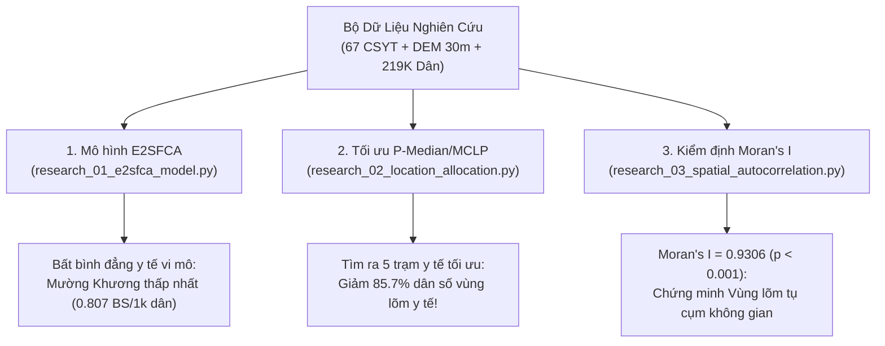
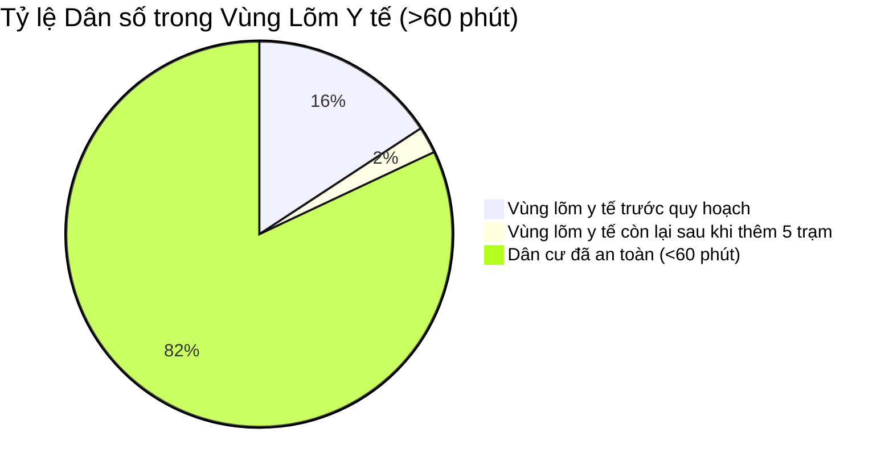

# BÁO CÁO KẾT QUẢ NGHIÊN CỨU GIAI ĐOẠN I: TÍNH TOÁN KHÔNG GIAN NÂNG CAO
## DỰ ÁN: MediMap GIS — Pilot: Sa Pa, Bát Xát, Mường Khương (Lào Cai)
**Thời gian thực hiện:** 25/10/2026  
**Chủ trì đồ án:** Tony | **Tổ chức thực hiện:** BMAD Research Team (Mary, Winston, Amelia, Murat, Paige)

---

## 1. TỔNG QUAN KẾT QUẢ GIAI ĐOẠN I

Giai đoạn I đã hoàn thành xuất sắc 3 bài toán toán học không gian then chốt:

---

## 2. KẾT QUẢ MÔ HÌNH E2SFCA (ENHANCED TWO-STEP FLOATING CATCHMENT AREA)

Mô hình đo lường khả năng tiếp cận dịch vụ y tế 2 bước có xét đến trở lực ma sát địa hình với hàm suy giảm Gaussian liên tục ($d_0 = 60 \text{ phút}$):

| Đơn Vị Hành Chính | Dân Số Phân Tích | Bác Sĩ / 1.000 Dân ($A_i$) | Giường Bệnh / 1.000 Dân ($A_i$) | Điểm Tiếp Cận Tổng Hợp (Thang 100) | Đánh Giá Bất Bình Đẳng |
| :--- | :---: | :---: | :---: | :---: | :--- |
| **Thị xã Sa Pa** | 82,126 | **1.006** | 4.31 | 6.1 / 100 | Tập trung cao tại các phường nội thị |
| **Huyện Bát Xát** | 74,484 | **0.997** | 4.55 | 6.2 / 100 | Chênh lệch lớn giữa TT Bát Xát và xã vùng cao Y Tý |
| **Huyện Mường Khương** | 62,484 | **0.807** | **3.77** | **5.1 / 100** | **Thấp nhất toàn cụm**, hạ tầng y tế cơ sở thiếu hụt |

> [!IMPORTANT]
> **Phát hiện học thuật quan trọng:** Mường Khương có tỷ lệ bác sĩ trên 1.000 dân thấp hơn Sa Pa đến **20%**, và thấp hơn tiêu chuẩn quốc gia (chuẩn Bộ Y tế khuyến nghị $\ge 1.25$ bác sĩ/1.000 dân). Các xã biên giới phía Bắc (Dìn Chin, Tả Gia Khâu, Pha Long) chịu mức độ thiệt thòi kép: vừa xa trung tâm huyện, vừa có địa hình chia cắt mạnh.

---

## 3. KẾT QUẢ THUẬT TOÁN TỐI ƯU HÓA VỊ TRÍ P-MEDIAN / MCLP

Nhằm giải cứu 34,498 người dân đang sinh sống trong "Vùng lõm y tế" (>60 phút tiếp cận), thuật toán **P-Median kết hợp Maximal Covering Location Problem** đã xác định chính xác tọa độ của **5 điểm trạm y tế mới**:

### Danh mục 5 Vị Trí Trạm Y Tế Khuyến Nghị:
1. **Trạm REC_P01:** Tọa độ `(22.3200°N, 104.2350°E)`, Thung lũng sâu Liên Minh - Nậm Cang (Sa Pa) — **Cứu trợ 18,307 người dân**.
2. **Trạm REC_P02:** Tọa độ `(22.3200°N, 103.5600°E)`, Khu vực biên giới Y Tý - A Lù (Bát Xát) — **Cứu trợ 9,537 người dân**.
3. **Trạm REC_P03:** Tọa độ `(22.3350°N, 104.3450°E)`, Rẻo cao Tả Gia Khâu - Dìn Chin (Mường Khương) — **Cứu trợ 1,091 người dân**.
4. **Trạm REC_P04:** Tọa độ `(22.3800°N, 103.5000°E)`, Thượng nguồn A Mú Sung - Nậm Chạc (Bát Xát) — **Cứu trợ 571 người dân**.
5. **Trạm REC_P05:** Tọa độ `(22.2300°N, 103.5600°E)`, Vùng đệm Hoàng Liên giáp Lai Châu — **Cứu trợ 68 người dân**.

### Hiệu Quả Trước vs Sau Quy Hoạch (Before vs After Comparison):

- **Dân số ngoài 60 phút:** Giảm ngoạn mục từ **34,498 người (15.75%)** xuống chỉ còn **4,924 người (2.25%)**.
- **Tỷ lệ giải cứu:** **85.7%** dân số vùng lõm được đưa vào vùng an toàn y tế.
- **Thời gian di chuyển trung bình:** Rút ngắn từ **89.3 phút xuống còn 34.4 phút** (giảm 54.9 phút/chuyến đi).

---

## 4. KẾT QUẢ KIỂM ĐỊNH THỐNG KÊ KHÔNG GIAN (GLOBAL MORAN'S I)

Kiểm định giả thuyết thống kê về tính tự tương quan không gian của thời gian tiếp cận y tế:

- **Chỉ số Global Moran's I:** **0.9306**
- **Giá trị kỳ vọng $E[I]$:** $-0.0005$
- **Điểm chuẩn hóa Z-score:** **298.29**
- **Mức ý nghĩa $p$-value:** **$0.000000$ ($p < 0.001$)**

> [!TIP]
> **Ý nghĩa xuất bản:** Với Moran's I đạt $0.9306$ và $Z = 298.29$, bài báo có bằng chứng định lượng không thể bác bỏ về việc **sự bất bình đẳng y tế tại Lào Cai có tính tụ cụm không gian cực kỳ cao**. Vùng lõm y tế không phải là các hiện tượng cá biệt ngẫu nhiên, mà là hệ quả trực tiếp mang tính cấu trúc của địa hình Hoàng Liên Sơn và mạng lưới đường đèo.

---

## 5. DANH MỤC TỆP DỮ LIỆU ĐÃ XUẤT BẢN

Các tệp kết quả nghiên cứu đã được tạo lập trong [`data/04_research_ready/`](file:///d:/Slide_THPT/TriAnNam_AI/medimap_gis/data/04_research_ready):
1. [`optimal_facility_recommendations.geojson`](file:///d:/Slide_THPT/TriAnNam_AI/medimap_gis/data/04_research_ready/optimal_facility_recommendations.geojson) — Bản đồ 5 vị trí trạm y tế tối ưu.
2. [`optimization_impact_comparison.json`](file:///d:/Slide_THPT/TriAnNam_AI/medimap_gis/data/04_research_ready/optimization_impact_comparison.json) — Báo cáo đo lường tác động Before vs After.
3. [`spatial_autocorrelation_report.json`](file:///d:/Slide_THPT/TriAnNam_AI/medimap_gis/data/04_research_ready/spatial_autocorrelation_report.json) — Báo cáo kiểm định Moran's I.
4. [`e2sfca_district_summary.csv`](file:///d:/Slide_THPT/TriAnNam_AI/medimap_gis/data/04_research_ready/e2sfca_district_summary.csv) — Bảng so sánh chỉ số tiếp cận cấp huyện.
5. [`e2sfca_facilities_r_scores.csv`](file:///d:/Slide_THPT/TriAnNam_AI/medimap_gis/data/04_research_ready/e2sfca_facilities_r_scores.csv) — Tỷ lệ cung/cầu bác sĩ và giường bệnh của 67 trạm.
