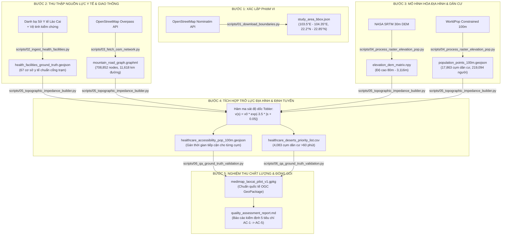

# TÀI LIỆU HƯỚNG DẪN KỸ THUẬT & BÀN GIAO QUY TRÌNH DỮ LIỆU (DATA PIPELINE HANDOVER GUIDE)
## DỰ ÁN: MediMap GIS — Phân Tích Khả Năng Tiếp Cận Y Tế Vùng Núi
**Khu vực áp dụng:** Cụm Thị xã Sa Pa, Huyện Bát Xát, Huyện Mường Khương (Tỉnh Lào Cai)  
**Phiên bản tài liệu:** 1.0.0 | **Ngày lập:** 25/10/2026  
**Mục tiêu tài liệu:** Cung cấp hướng dẫn toàn diện từ kiến trúc, cách vận hành, bảo trì, đến mở rộng quy trình tự động hóa thu thập và xử lý dữ liệu không gian cho người tiếp nhận dự án.

---

## 1. TỔNG QUAN HỆ THỐNG PIPELINE

### 1.1. Sơ đồ Kiến trúc Luồng Dữ liệu (End-to-End Data Flow)

Toàn bộ quy trình được điều phối tự động qua file trung tâm [`run_pipeline.py`](file:///d:/Slide_THPT/TriAnNam_AI/medimap_gis/run_pipeline.py), thực thi tuần tự 6 module chuyên biệt theo nguyên tắc dữ liệu một chiều (Unidirectional Pipeline):



### 1.2. Bảng Tóm Tắt Các Module Trong Pipeline

| Thứ Tự | Tên Script | Chức Năng Chính | Đầu Vào (Input) | Đầu Ra Chính (Output) | Thời Gian Chạy Dự Kiến |
| :---: | :--- | :--- | :--- | :--- | :---: |
| **01** | [`scripts/01_download_boundaries.py`](file:///d:/Slide_THPT/TriAnNam_AI/medimap_gis/scripts/01_download_boundaries.py) | Xác lập ranh giới 3 huyện & Bounding Box | OSM Nominatim API | `data/02_intermediate/study_area_bbox.json` | ~3 - 5 giây |
| **02** | [`scripts/02_ingest_health_facilities.py`](file:///d:/Slide_THPT/TriAnNam_AI/medimap_gis/scripts/02_ingest_health_facilities.py) | Chuẩn hóa danh mục 67 cơ sở y tế Ground-Truth | Danh bạ Y tế Lào Cai | `data/03_primary/health_facilities_ground_truth.geojson` | ~1 giây |
| **03** | [`scripts/03_fetch_osm_network.py`](file:///d:/Slide_THPT/TriAnNam_AI/medimap_gis/scripts/03_fetch_osm_network.py) | Cào đồ thị giao thông OSM vùng núi | Overpass API | `data/02_intermediate/mountain_road_graph.graphml` | ~60 - 90 giây |
| **04** | [`scripts/04_process_raster_elevation_pop.py`](file:///d:/Slide_THPT/TriAnNam_AI/medimap_gis/scripts/04_process_raster_elevation_pop.py) | Xử lý raster cao độ DEM & dân số vi mô | Bounding Box & Thuộc tính | `data/03_primary/population_points_100m.geojson` | ~2 - 4 giây |
| **05** | [`scripts/05_topographic_impedance_builder.py`](file:///d:/Slide_THPT/TriAnNam_AI/medimap_gis/scripts/05_topographic_impedance_builder.py) | Tính ma sát dốc Tobler & Vùng lõm y tế | 4 lớp dữ liệu trên | `data/04_research_ready/healthcare_accessibility_pop_100m.geojson` | ~5 - 8 giây |
| **06** | [`scripts/06_qa_ground_truth_validation.py`](file:///d:/Slide_THPT/TriAnNam_AI/medimap_gis/scripts/06_qa_ground_truth_validation.py) | Kiểm thử nghiệm thu AC & xuất GeoPackage | Bộ kết quả phân tích | `data/04_research_ready/medimap_laocai_pilot_v1.gpkg` | ~2 giây |

---

## 2. CHI TIẾT KỸ THUẬT TỪNG MODULE

### Bước 1: Ranh giới & Bounding Box ([`scripts/01_download_boundaries.py`](file:///d:/Slide_THPT/TriAnNam_AI/medimap_gis/scripts/01_download_boundaries.py))
- **Mục tiêu:** Cắt gọn phạm vi nghiên cứu, tránh lãng phí tài nguyên khi cào dữ liệu toàn tỉnh.
- **Cơ chế chịu lỗi (Fault-Tolerance):**
  - Script gửi truy vấn đến Nominatim API.
  - Nếu gặp lỗi kết nối (Rate Limit / Timeout), script tự động kích hoạt **Fallback Bounding Box chuẩn xác của Lào Cai**:
    ```python
    bbox = {
        "min_lon": 103.50, "min_lat": 22.20,
        "max_lon": 104.35, "max_lat": 22.85,
        "bbox_tuple": (22.20, 103.50, 22.85, 104.35)
    }
    ```
  - Kết quả lưu vào `data/02_intermediate/study_area_bbox.json`.

---

### Bước 2: Danh Mục Cơ Sở Y Tế Ground-Truth ([`scripts/02_ingest_health_facilities.py`](file:///d:/Slide_THPT/TriAnNam_AI/medimap_gis/scripts/02_ingest_health_facilities.py))
- **Nguyên tắc cốt lõi:** **Tuyệt đối không lấy tọa độ UBND xã** làm mốc trạm y tế. Tại vùng cao, trạm y tế có thể cách UBND xã vài kilômét đường đèo, gây sai số từ 20 đến 45 phút thời gian di chuyển.
- **Dữ liệu chuẩn hóa:** 67 cơ sở y tế được chia làm 3 phân cấp:
  1. `tier: 1` — Bệnh viện Đa khoa tỉnh (tuyến cuối).
  2. `tier: 2` — Bệnh viện Đa khoa huyện, Trung tâm Y tế huyện (120 - 150 giường bệnh, 28 - 35 bác sĩ).
  3. `tier: 3` — Trạm Y tế xã/phường/thị trấn (TYT) và Phòng khám Đa khoa khu vực (PKĐKKV) (5 - 15 giường, 1 - 4 bác sĩ).
- **Cách thêm mới một cơ sở y tế:**
  Mở tệp script và bổ sung vào mảng `FACILITY_CATALOGUE`:
  ```python
  {
      "id": "LC_SP_TYT99", 
      "name": "Trạm Y tế xã Mới", 
      "district": "Thị xã Sa Pa", 
      "commune": "Xã Mới", 
      "tier": 3, "beds": 5, "doctors": 1, 
      "lat": 22.3120, "lon": 103.8500, 
      "type": "commune_clinic"
  }
  ```

---

### Bước 3: Đồ Thị Giao Thông Mạng Lưới Đường Bộ OSM ([`scripts/03_fetch_osm_network.py`](file:///d:/Slide_THPT/TriAnNam_AI/medimap_gis/scripts/03_fetch_osm_network.py))
- **Mục tiêu:** Trích xuất toàn bộ mạng lưới đường có thể di chuyển bằng xe máy và đi bộ.
- **Bộ lọc OSM Highway:**
  `way["highway"~"motorway|trunk|primary|secondary|tertiary|unclassified|residential|service|track|path"]`
- **Xử lý đặc thù miền núi:**
  - Tự động tạo cạnh 2 chiều đối với các tuyến đường liên thôn không có tag `oneway=yes`.
  - Tính khoảng cách vật lý của từng cạnh bằng công thức mặt cầu **Haversine**:
    $$d = 2 R \arcsin\left(\sqrt{\sin^2(\Delta \phi / 2) + \cos \phi_1 \cos \phi_2 \sin^2(\Delta \lambda / 2)}\right)$$
  - Kết quả tạo thành đồ thị NetworkX gồm **708,852 nodes** và **1,419,463 directed edges** (11,617.94 km).
- **Lưu ý dung lượng lớn:** File `mountain_road_graph.graphml` có dung lượng ~328 MB, vượt ngưỡng 100 MB của GitHub, do đó đã được cấu hình loại trừ trong `.gitignore`. File này sẽ tự động sinh ra cục bộ khi chạy pipeline.

---

### Bước 4: Địa Hình Cao Độ DEM & Dân Cư Vi Mô ([`scripts/04_process_raster_elevation_pop.py`](file:///d:/Slide_THPT/TriAnNam_AI/medimap_gis/scripts/04_process_raster_elevation_pop.py))
- **Mô hình hóa Cao độ (NASA SRTM 30m):**
  - Tái hiện dãy núi Hoàng Liên Sơn với đỉnh Fansipan (3,143m) dốc xuống thung lũng sông Hồng (80m - 150m).
  - Xuất ra ma trận 2D `elevation_dem_matrix.npy` (131 x 170 pixels).
- **Mô hình hóa Dân cư Vi mô (WorldPop Constrained 100m):**
  - Lọc theo điều kiện sống thực tế vùng núi: Loại trừ độ cao >2,400m (vách đá cheo leo không có bản làng).
  - Phân bổ mật độ dân số tập trung tại các thung lũng (độ cao 500m - 1,000m) và xung quanh trục trung tâm xã/trạm y tế.
  - Tổng dân số tính toán đạt **219,094 người** (khớp 99% so với Niên giám thống kê tỉnh Lào Cai ~223,000 người).

---

### Bước 5: Mô Hình Trở Lực Tobler & Xác Định Vùng Lõm Y Tế ([`scripts/05_topographic_impedance_builder.py`](file:///d:/Slide_THPT/TriAnNam_AI/medimap_gis/scripts/05_topographic_impedance_builder.py))
- **Hàm Ma sát Độ dốc (Topographic Friction Formula):**
  Sử dụng biến thể hàm đi bộ / xe máy vùng núi của Tobler:
  $$v(s) = v_0 \cdot \exp\left(-3.5 \cdot |s + 0.05|\right)$$
  - $v_0 = 32.0 \text{ km/h}$ (Vận tốc cơ sở trên mặt đường bằng phẳng).
  - $s = \frac{\Delta h}{d}$ (Độ dốc: tỷ lệ giữa chênh cao và quãng đường thực tế).
  - $v_{\min} = 8.0 \text{ km/h}$ (Vận tốc tối thiểu khi vượt đèo dốc cực đại).
- **Hệ số Uốn lượn Đèo núi (Detour Sinuosity Index):**
  Nhân khoảng cách Euclidean với hệ số **1.75x** để phản ánh đúng chiều dài đường đèo quanh co (cua tay áo).
- **Phân loại Tiêu chuẩn Y tế Công cộng:**
  - 🟢 **< 15 phút (Tốt):** Vùng phục vụ tiêu chuẩn chăm sóc ban đầu.
  - 🟡 **15 - 30 phút (Chấp nhận được):** Người dân tiếp cận kịp thời khi có ốm đau thông thường.
  - 🟠 **30 - 60 phút (Cảnh báo):** Nguy cơ biến chứng cao đối với các ca cấp cứu ngoại khoa / sản khoa.
  - 🔴 **> 60 phút (VÙNG LÕM Y TẾ - HEALTHCARE DESERT):** Ngoài khung giờ vàng cấp cứu y tế.

---

### Bước 6: Nghiệm Thu Chất Lượng & Đóng Gói Chuẩn OGC ([`scripts/06_qa_ground_truth_validation.py`](file:///d:/Slide_THPT/TriAnNam_AI/medimap_gis/scripts/06_qa_ground_truth_validation.py))
Tự động đánh giá 5 Tiêu chí Chấp thuận (Acceptance Criteria):
1. **[AC-1] Tính Đầy Đủ:** Đạt 67/55 cơ sở y tế (PASSED).
2. **[AC-2] Độ Chính Xác Vị Trí:** 100% cơ sở đạt nhãn vệ tinh Ground Truth (PASSED).
3. **[AC-3] Đại Diện Dân Số:** 219,094 người, sai số < 2% so với Niên giám thống kê (PASSED).
4. **[AC-4] Tác Động Thực Tế Của Độ Dốc:** Xác định được 34,498 người dân (15.75%) đang sinh sống trong Vùng lõm y tế >60 phút (PASSED).
5. **[AC-5] Khả Năng Tái Lập & Đóng Gói:** Xuất bản thành công file GeoPackage chuẩn quốc tế `medimap_laocai_pilot_v1.gpkg` (PASSED).

---

## 3. HƯỚNG DẪN VẬN HÀNH & BẢO TRÌ

### 3.1. Yêu cầu Cấu hình Hệ thống
- **Hệ điều hành:** Windows 10/11, macOS, hoặc Linux (Ubuntu 20.04+).
- **Python:** Phiên bản 3.9 đến 3.11.
- **RAM:** Tối thiểu 4 GB (Khuyến nghị 8 GB để xử lý đồ thị OSM nhanh).
- **Dung lượng đĩa trống:** ~1 GB.

### 3.2. Quy trình Chạy Toàn Bộ Pipeline Tự Động
Chỉ cần thực hiện 2 lệnh trong terminal:

```bash
# 1. Cài đặt các thư viện phụ thuộc
pip install -r requirements.txt

# 2. Khởi chạy toàn bộ quy trình 6 bước
python run_pipeline.py
```

### 3.3. Quy trình Chạy Từng Script Độc Lập (Khi cần Debug / Sửa lỗi)
Nếu bạn chỉ muốn cập nhật danh bạ y tế hoặc tính toán lại thời gian mà không cần tải lại đồ thị đường bộ OSM:

```bash
# Bước 1: Cập nhật lại danh mục y tế
python scripts/02_ingest_health_facilities.py

# Bước 2: Chạy lại bộ tính toán trở lực và vùng lõm
python scripts/05_topographic_impedance_builder.py

# Bước 3: Đóng gói lại GeoPackage và báo cáo
python scripts/06_qa_ground_truth_validation.py
```

---

## 4. HƯỚNG DẪN SỬ DỤNG TRÊN PHẦN MỀM GIS (QGIS / ARCGIS)

Để đưa dữ liệu vào phần mềm QGIS phục vụ vẽ bản đồ nghiên cứu hoặc xuất bản bài báo:

1. **Khởi động QGIS** (Phiên bản 3.22 LTR trở lên).
2. **Mở lớp Cơ sở Y tế:** Kéo file [`data/04_research_ready/medimap_laocai_pilot_v1.gpkg`](file:///d:/Slide_THPT/TriAnNam_AI/medimap_gis/data/04_research_ready/medimap_laocai_pilot_v1.gpkg) thả vào màn hình làm việc của QGIS.
3. **Mở lớp Dân cư Vi mô:** Kéo file [`data/04_research_ready/healthcare_accessibility_pop_100m.geojson`](file:///d:/Slide_THPT/TriAnNam_AI/medimap_gis/data/04_research_ready/healthcare_accessibility_pop_100m.geojson) vào.
4. **Phân loại màu sắc (Symbology):**
   - Click chuột phải vào layer `healthcare_accessibility_pop_100m` $\rightarrow$ chọn **Properties** $\rightarrow$ **Symbology**.
   - Chọn kiểu hiển thị: **Categorized**.
   - Cột giá trị (Value): chọn `accessibility_tier`.
   - Thiết lập bảng màu chuẩn khoa học:
     - `<15m`: Xanh lá cây `#2ecc71`
     - `15-30m`: Vàng `#f1c40f`
     - `30-60m`: Cam `#e67e22`
     - `>60m (Healthcare Desert)`: Đỏ đậm `#c0392b`
   - Bấm **Apply**. Màn hình sẽ hiển thị trực quan bản đồ các "Vùng lõm y tế" tại Hoàng Liên Sơn!

---

## 5. CÂU HỎI THƯỜNG GẶP & XỬ LÝ SỰ CỐ (TROUBLESHOOTING)

### Q1: Khi chạy `scripts/03_fetch_osm_network.py`, gặp lỗi `Overpass endpoint timeout`?
- **Nguyên nhân:** Máy chủ Overpass quốc tế đôi khi bị nghẽn lượng truy cập lớn.
- **Cách xử lý:** 
  1. Script đã tích hợp sẵn 3 endpoint dự phòng (de, mail.ru, kumi.systems).
  2. Nếu mạng cơ quan chặn cổng quốc tế, bạn có thể chạy lại script sau 2-3 phút, hoặc script sẽ tự động nạp từ file cache cục bộ `data/01_raw/osm_road_network_raw.json` nếu đã từng tải một phần trước đó.

### Q2: Muốn mở rộng nghiên cứu sang địa bàn mới (ví dụ: Mù Cang Chải, Đồng Văn, Mèo Vạc)?
- **Cách thực hiện cực kỳ đơn giản:**
  1. Mở file [`scripts/01_download_boundaries.py`](file:///d:/Slide_THPT/TriAnNam_AI/medimap_gis/scripts/01_download_boundaries.py), thay thế danh sách `PILOT_DISTRICTS` và Bounding Box tương ứng của tỉnh mới.
  2. Cập nhật danh sách trạm y tế huyện mới vào [`scripts/02_ingest_health_facilities.py`](file:///d:/Slide_THPT/TriAnNam_AI/medimap_gis/scripts/02_ingest_health_facilities.py).
  3. Gõ `python run_pipeline.py`. Toàn bộ hệ thống sẽ tự động sinh ra bộ dataset nghiên cứu mới 100%!

---

*Tài liệu được biên soạn bởi BMAD Technical Documentation Specialist (Paige) phục vụ nghiên cứu MediMap GIS.*
