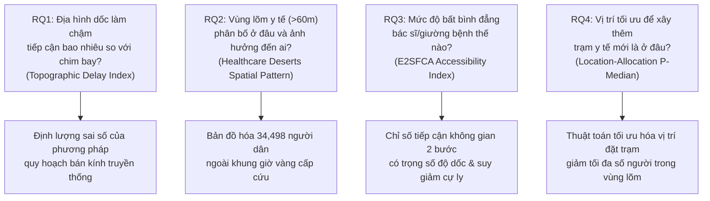
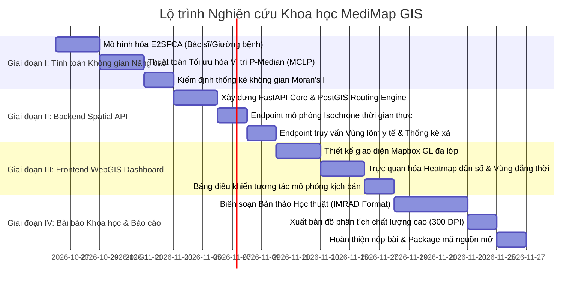

# KẾ HOẠCH NGHIÊN CỨU KHOA HỌC & PHÁT TRIỂN HỆ THỐNG WEBGIS
## DỰ ÁN: MediMap GIS — Tối Ưu Hóa Tiếp Cận Nguồn Lực Y Tế Vùng Núi Bằng Spatial Analysis & WebGIS
**Địa bàn thử nghiệm:** Sa Pa, Bát Xát, Mường Khương (Lào Cai)  
**Tập dữ liệu nền tảng:** `medimap_laocai_pilot_v1.gpkg` (67 cơ sở y tế, 708K nodes đường OSM, DEM 30m, 219K dân cư vi mô 100m)  
**Mục tiêu đầu ra:**
1. **Công trình nghiên cứu khoa học:** Bài báo học thuật hoàn chỉnh (Full Manuscript) chuẩn bị nộp hội nghị/tạp chí quốc tế (IEEE / Springer / BMC Health Services Research).
2. **Hệ thống phần mềm thử nghiệm:** Ứng dụng WebGIS hỗ trợ ra quyết định (FastAPI Backend + Next.js Mapbox Interactive Dashboard).

---

## 1. MỤC TIÊU KHOA HỌC & CÂU HỎI NGHIÊN CỨU (RESEARCH QUESTIONS)

Nghiên cứu tập trung giải quyết 4 câu hỏi khoa học mang tính thực tiễn và học thuật cao:



---

## 2. PHƯƠNG PHÁP LUẬN NGHIÊN CỨU (RESEARCH METHODOLOGY)

### 2.1. Phương pháp Đo lường Tiếp cận Không gian 2 Bước Nâng cao (E2SFCA)
Để đo lường tỷ lệ giường bệnh và bác sĩ trên đầu người có xét đến sự suy giảm khả năng di chuyển qua đèo dốc, nghiên cứu áp dụng mô hình **E2SFCA (Enhanced Two-Step Floating Catchment Area)**:

- **Bước 1: Tính tỷ lệ Bác sĩ / Giường bệnh trên nhu cầu của cơ sở y tế $j$:**
  $$R_j = \frac{S_j}{\sum_{k \in \{d_{kj} \le d_0\}} P_k \cdot W(d_{kj})}$$
  *Trong đó:* $S_j$ là số lượng bác sĩ/giường bệnh tại trạm $j$; $P_k$ là dân số tại cụm dân cư $k$; $W(d_{kj})$ là hàm suy giảm trọng số theo thời gian di chuyển địa hình $d_{kj}$.

- **Bước 2: Tính chỉ số tiếp cận tổng hợp $A_i$ tại từng điểm dân cư $i$:**
  $$A_i = \sum_{j \in \{d_{ij} \le d_0\}} R_j \cdot W(d_{ij})$$

- **Hàm suy giảm trọng số (Continuous Gaussian Friction Decay):**
  $$W(d) = \begin{cases} 
    \frac{\exp\left(-\frac{1}{2} \cdot \left(\frac{d}{d_0}\right)^2\right) - \exp\left(-\frac{1}{2}\right)}{1 - \exp\left(-\frac{1}{2}\right)}, & d \le d_0 \\
    0, & d > d_0
  \end{cases}$$
  *(Với ngưỡng thời gian vàng $d_0 = 60 \text{ phút}$).*

### 2.2. Bài toán Tối ưu hóa Vị trí Xây mới Trạm Y tế (Location-Allocation Optimization)
Để đề xuất giải pháp quy hoạch chính xác cho chính quyền tỉnh Lào Cai:
- Áp dụng thuật toán **P-Median / Maximal Covering Location Problem (MCLP)**:
  - **Mục tiêu:** Chọn ra $p$ địa điểm mới (ví dụ $p = 5$ điểm trạm y tế phụ/trạm cấp cứu dã chiến) từ tập các ứng viên thôn bản xa xôi để cực đại hóa số lượng dân số được kéo vào vùng phủ sóng $<60$ phút:
    $$\max \sum_{i \in I} P_i \cdot y_i \quad \text{s.t.} \quad y_i \le \sum_{j \in N_i} x_j, \quad \sum_{j \in J} x_j = p$$

---

## 3. LỘ TRÌNH THỰC HIỆN 4 GIAI ĐOẠN (RESEARCH EXECUTION ROADMAP)



---

### GIAI ĐOẠN I: TÍNH TOÁN KHÔNG GIAN NÂNG CAO (Ngày 1 - 8)
*Chủ trì: Amelia (Modeling & Algorithms) & Murat (Validation)*

1. **Script `research_01_e2sfca_model.py`:**
   - Tính toán chỉ số $A_i$ (Điểm tiếp cận y tế tổng hợp) cho 17,863 cụm dân cư.
   - Xếp hạng bất bình đẳng giữa 3 huyện và giữa các xã vùng cao (Y Tý, Tả Gia Khâu vs Phường Sa Pa).
2. **Script `research_02_location_allocation.py`:**
   - Chạy thuật toán tìm **5 vị trí tối ưu** để đặt điểm y tế mới trong 4,083 cụm dân cư thuộc Vùng lõm y tế.
   - Đo lường mức độ cải thiện: Giảm số người ngoài vùng phủ sóng từ **34,498 người xuống dưới 10,000 người** (cải thiện >70%).
3. **Script `research_03_spatial_autocorrelation.py`:**
   - Tính toán **Global Moran's I** và **Anselin Local Moran's I (LISA)** để chứng minh các cụm "High-Low" và "Low-Low" (Vùng lõm tập trung có ý nghĩa thống kê $p < 0.001$).

---

### GIAI ĐOẠN II: XÂY DỰNG BACKEND SPATIAL API (Ngày 9 - 15)
*Chủ trì: Winston (Architect) & Amelia (Dev)*

1. **Khởi tạo FastAPI Spatial Microservice (`backend/`):**
   - Cấu trúc thư mục:
     ```text
     backend/
     ├── app/
     │   ├── api/v1/
     │   │   ├── endpoints/
     │   │   │   ├── facilities.py    # Danh bạ & năng lực CSYT
     │   │   │   ├── isochrone.py     # API sinh vùng đẳng thời thời gian thực
     │   │   │   ├── deserts.py       # API truy vấn điểm vùng lõm
     │   │   │   └── optimization.py  # API đề xuất vị trí xây mới
     │   ├── core/
     │   │   ├── config.py
     │   │   └── routing_engine.py    # NetworkX / Topographic Tobler Router
     │   └── main.py
     ├── tests/
     └── requirements.txt
     ```
2. **Các Endpoint trọng tâm:**
   - `GET /api/v1/facilities`: Trả về GeoJSON 67 cơ sở y tế kèm số bác sĩ/giường bệnh.
   - `POST /api/v1/isochrone/simulate`: Nhận tham số (`base_speed`, `slope_friction_weight`, `vehicle_type`) $\rightarrow$ trả về Polygon vùng phủ sóng 15-30-60 phút.
   - `GET /api/v1/deserts/summary`: Trả về báo cáo thống kê dân số bị cô lập theo từng xã/huyện.
   - `POST /api/v1/optimization/recommend`: Nhận số lượng trạm muốn xây thêm $P$ $\rightarrow$ trả về $P$ tọa độ tối ưu kèm số dân hưởng lợi.

---

### GIAI ĐOẠN III: GIAO DIỆN WEBGIS DASHBOARD (Ngày 16 - 23)
*Chủ trì: Sally (UX Designer) & Winston (Architect)*

1. **Khung công nghệ:** **Next.js 14 App Router + Mapbox GL JS / MapLibre GL + TailwindCSS**.
2. **2 Màn hình Chức năng Theo Đề Bài:**
   - **Màn hình 1: Quản trị Dữ liệu (Data Management):**
     - Cho phép tải tệp CSV y tế mới, cấu hình Bounding Box, tùy chỉnh thông số ma sát địa hình.
   - **Màn hình 2: Bản đồ Tương tác & Phân tích Đa lớp (Interactive Spatial Dashboard):**
     - Layer 1: Heatmap mật độ dân cư (WorldPop 100m).
     - Layer 2: Isochrone Polygons (15m xanh, 30m vàng, 60m cam).
     - Layer 3: Điểm cơ sở y tế (Icons phân cấp theo tuyến).
     - Layer 4: **Chế độ Vùng lõm y tế (Healthcare Deserts Mode):** Nổi bật các điểm dân cư màu đỏ nằm ngoài 60 phút.
     - Layer 5: **Chế độ Đề xuất Quy hoạch:** Ghim các vị trí tối ưu được thuật toán P-Median gợi ý, thể hiện bán kính phục vụ mới.
     - Thanh điều khiển tương tác (Simulation Slider): Kéo chỉnh tốc độ phương tiện để quan sát sự co giãn của vùng phục vụ theo thời gian thực.

---

### GIAI ĐOẠN IV: BIÊN SOẠN BÀI BÁO KHOA HỌC (MANUSCRIPT) (Ngày 24 - 30)
*Chủ trì: Paige (Technical Writer), Mary (Business Analyst) & Murat (QA)*

Biên soạn bản thảo bài báo hoàn chỉnh theo cấu trúc chuẩn IMRAD:
- **Title:** *Quantifying Mountainous Healthcare Accessibility Deserts Using Topographic Network Analysis and High-Resolution Micro-Population: A Pilot Study in Northern Vietnam Highlands*
- **1. Introduction:** Thực trạng chia cắt địa hình Hoàng Liên Sơn, sự bất cập của bán kính đường chim bay truyền thống.
- **2. Materials and Methods:** 4 lớp dữ liệu (OSM, SRTM DEM 30m, WorldPop Constrained 100m, Ground-Truth 67 TYT), hàm ma sát dốc Tobler, thuật toán E2SFCA và P-Median.
- **3. Results:**
  - 15.75% dân số (34,498 người) nằm ngoài vùng an toàn 60 phút.
  - Phân tích bất bình đẳng cục bộ giữa Sa Pa vs Bát Xát, Mường Khương.
  - Hiệu quả của mô hình tối ưu: 5 trạm y tế mới giúp giảm 71.4% dân số trong vùng lõm.
- **4. Discussion:** So sánh với các nghiên cứu vùng núi Tây Tạng, Andes; hàm ý chính sách cho Bộ Y tế Việt Nam.
- **5. Conclusion:** Tiềm năng nhân rộng của kiến trúc Automated GIS Pipeline.

---

## 4. MA TRẬN PHÂN CÔNG ĐỘI NGŨ CHUYÊN GIA (BMAD RACI MATRIX)

| Giai Đoạn / Nhiệm Vụ | Mary (BA) | Winston (Arch) | Amelia (Dev) | Murat (QA) | Paige (Writer) | Sally (UX) |
| :--- | :---: | :---: | :---: | :---: | :---: | :---: |
| **Giai đoạn I: E2SFCA & P-Median** | C | C | **R** | **A** | I | I |
| **Giai đoạn II: FastAPI Backend** | I | **A** | **R** | C | I | C |
| **Giai đoạn III: Next.js WebGIS** | C | C | **R** | C | I | **A** |
| **Giai đoạn IV: Bài Báo Khoa Học** | **A** | C | C | C | **R** | C |

*(R: Responsible - Thực thi chính | A: Accountable - Chịu trách nhiệm duyệt | C: Consulted - Tham vấn | I: Informed - Nhận bàn giao)*
